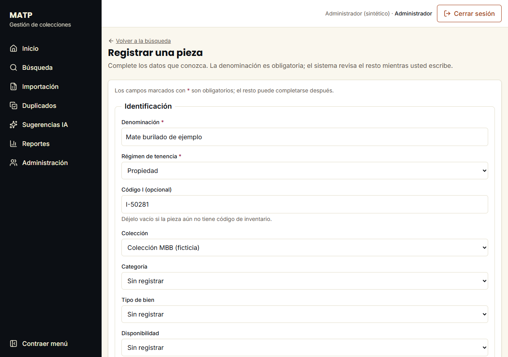
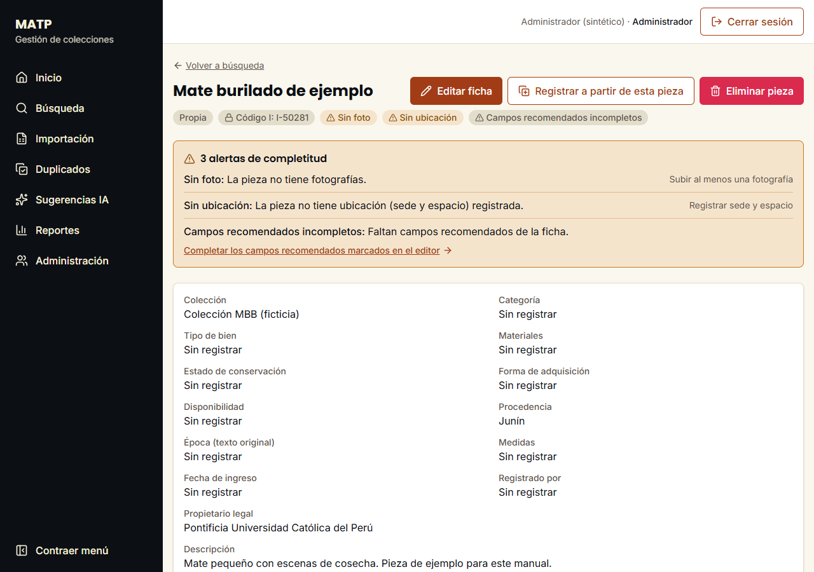
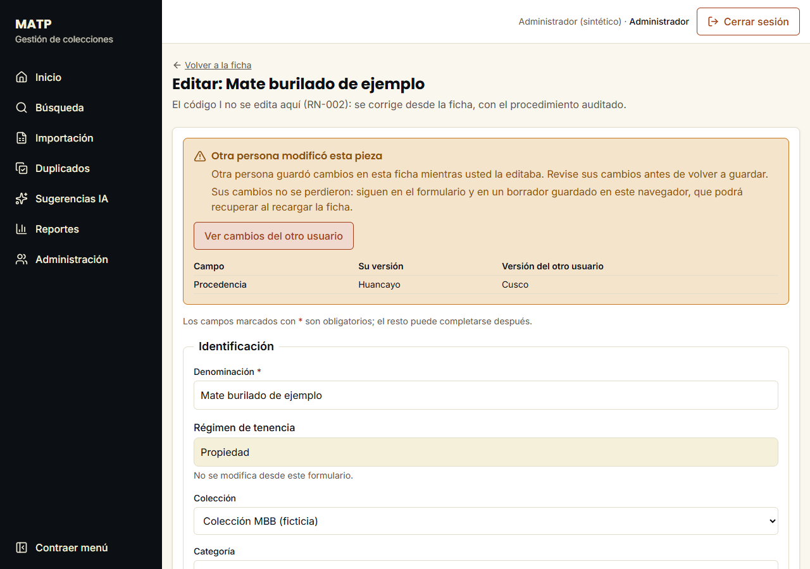
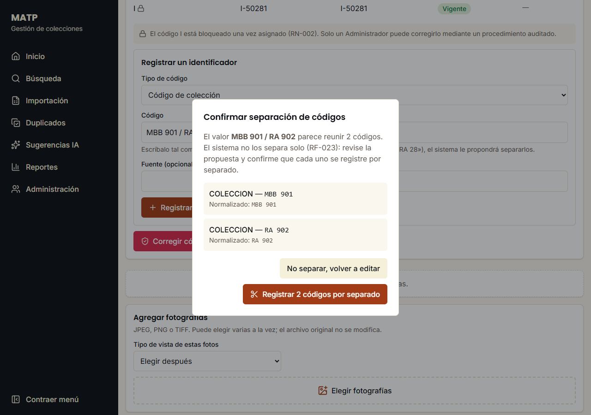
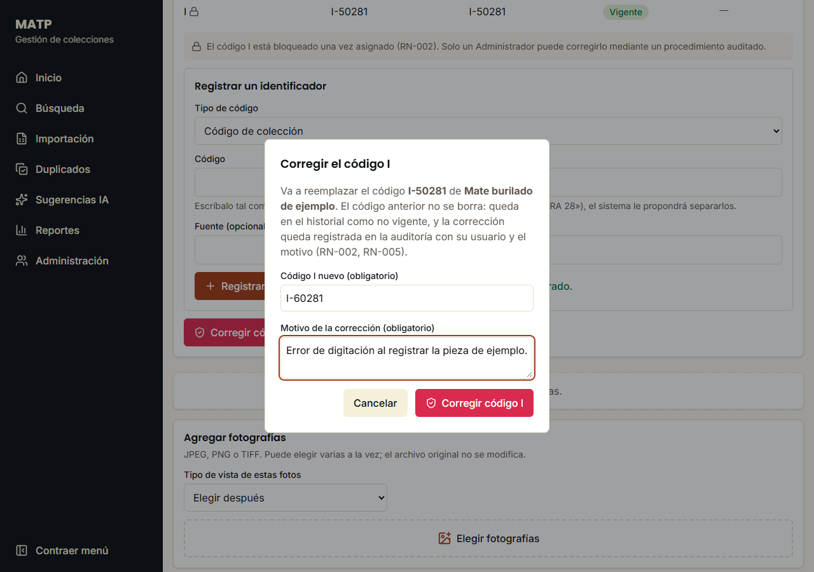
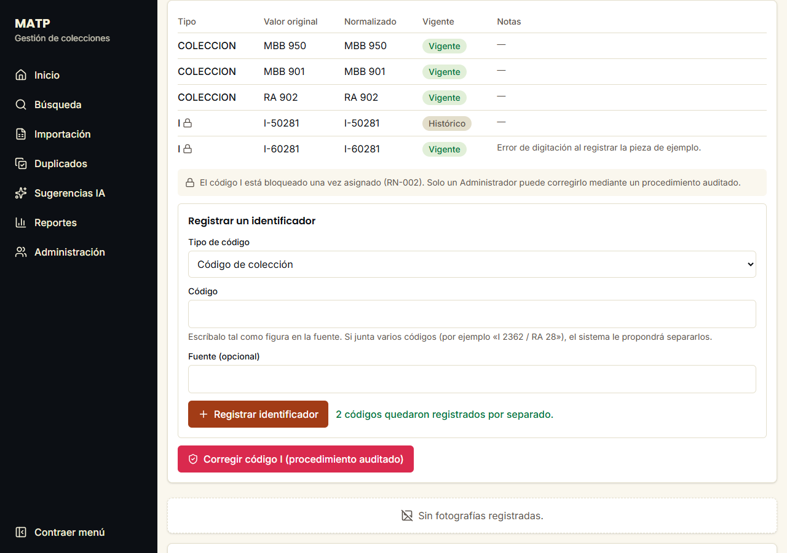
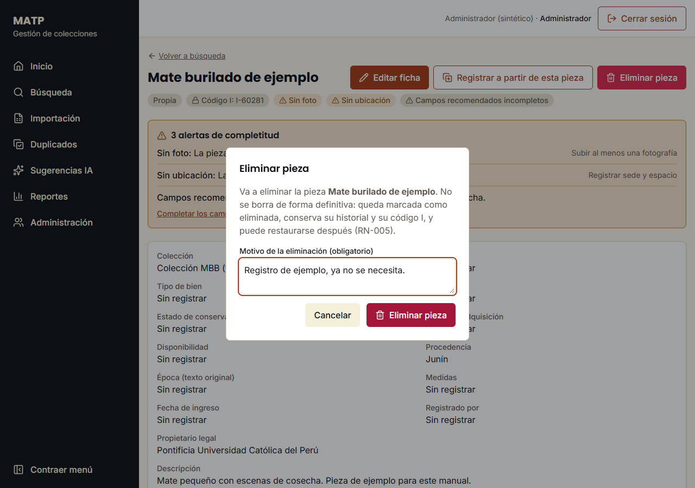
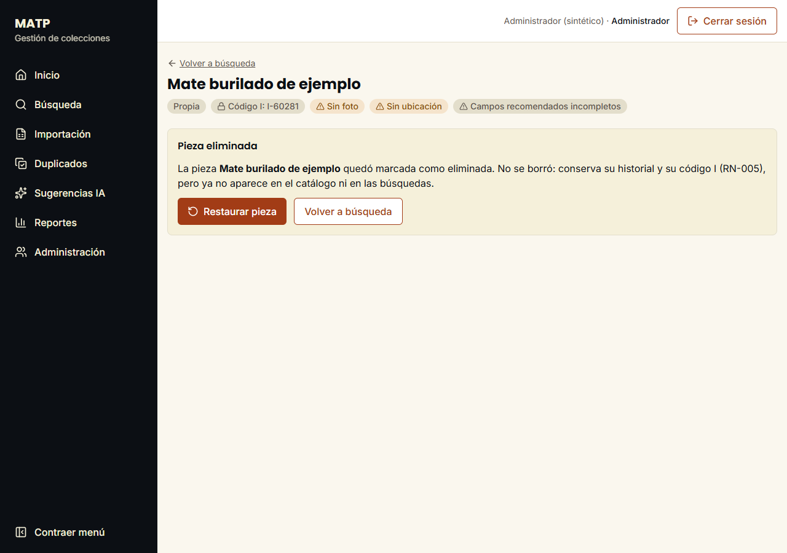
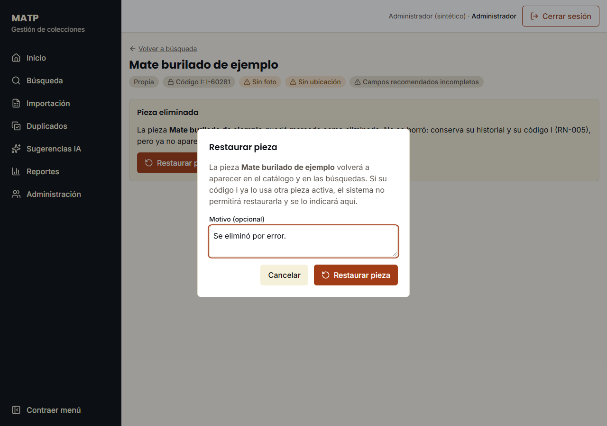

# Catálogo

> Secciones escritas por cada change: alta, edición, conflictos, códigos, eliminación y restauración llegan con `ficha-pieza-crud`; la conservación, con `colecciones-y-vocabularios-admin`; el registro a mano de piezas seguidas, con `crud-manual-completo`.

## Registrar una pieza

Pueden hacerlo el Catalogador, la Gestora de colecciones y el Administrador.

1. En **Búsqueda**, pulse **Nueva pieza**.
2. Escriba la **Denominación** y elija el **Régimen de tenencia**. Son los únicos datos obligatorios: el resto puede completarse después.
3. Si la pieza ya tiene código de inventario, escríbalo en **Código I**. Si no, déjelo vacío.
4. Complete lo que conozca. Mientras escribe, el sistema revisa los datos y avisa junto a cada campo.
5. Pulse **Registrar pieza**. Se abre la ficha de la pieza.

La ficha avisa de lo que falta, como la foto, la ubicación o los campos recomendados. Estos avisos no impiden guardar.

Conviene saber:

- **Comodato.** Al elegirlo aparecen **Comodante** y **Convenio de comodato**.
- **Código I.** Es solo para piezas en propiedad. Una vez asignado, solo un Administrador puede corregirlo (vea [Corregir el código I](#corregir-el-código-i)).
- **Borrador.** Lo que escribe se guarda en este navegador. Si cierra la página sin registrar, al volver verá «Se recuperó un borrador sin guardar». Para empezar de cero, pulse **Descartar borrador**.

### Si algo sale mal

| Qué ve | Qué hacer |
|---|---|
| «La denominación es obligatoria» | Escriba la denominación. |
| «El código … ya está asignado a otra pieza activa» | Ese código ya lo tiene otra pieza, y **Registrar pieza** queda apagado. Revise el código en la pieza física. |
| «Una pieza en comodato no puede recibir Código de inventario general (I)» | **Registrar pieza** queda apagado. Borre el código I o revise el régimen de tenencia. |

## Editar una pieza

Pueden hacerlo el Catalogador, la Gestora de colecciones y el Administrador.

1. En la ficha, pulse **Editar ficha**.
2. Cambie los datos.
3. Pulse **Guardar cambios**. El formulario sigue abierto y muestra «Cambios guardados».
4. Para salir, pulse **Volver a la ficha**.

Cada cambio queda en la auditoría, con quién lo hizo y cuándo.

Aquí no se cambian el **Régimen de tenencia**, el **Propietario legal** ni el **código I**. El código I se corrige desde la ficha: vea [Corregir el código I](#corregir-el-código-i).

### Si otra persona guardó antes que usted

Si dos personas editan la misma pieza, la segunda en guardar ve el aviso **Otra persona modificó esta pieza**. Lo que usted escribió no se pierde: sigue en el formulario.

1. Pulse **Ver cambios del otro usuario**. La tabla muestra cada dato que la otra persona cambió, con su versión y la de esa persona.
2. Si quiere conservar un cambio de la otra persona, escriba ese valor en su formulario.
3. Pulse **Guardar cambios**.

**Cuidado:** al guardar, todo lo que está en su formulario reemplaza a lo guardado. Un dato de la tabla que usted deje como está vuelve a su versión, y se pierde el cambio de la otra persona.

### Si algo sale mal

| Qué ve | Qué hacer |
|---|---|
| «La denominación es obligatoria» | Una pieza no puede quedar sin denominación. Escríbala de nuevo. |
| «Otra persona guardó cambios en esta ficha mientras usted la editaba» | Siga los pasos de arriba. |
| «Se recuperó un borrador sin guardar» | Revise los datos antes de guardar: la ficha pudo cambiar después. Si no le sirve, pulse **Descartar borrador**. |

## Registrar otros códigos de la pieza

Pueden hacerlo el Catalogador, la Gestora de colecciones y el Administrador.

La tabla de la ficha muestra todos los códigos de la pieza. Los que ya no se usan dicen **Histórico**: no se borran, y la búsqueda sigue encontrando la pieza por ellos.

1. En la ficha, vaya a **Registrar un identificador**, debajo de la tabla.
2. Elija el **Tipo de código**.
3. Escriba el **Código** tal como figura en la fuente. Si quiere, indique de dónde salió en **Fuente**.
4. Pulse **Registrar identificador**. El código aparece en la tabla.

Una pieza en propiedad que aún no tiene código I lo recibe aquí, con el tipo **Código de inventario general (I)**.

### Si el valor junta varios códigos

Si escribe, por ejemplo, `MBB 901 / RA 902`, el sistema no lo separa por su cuenta: le muestra una propuesta.

1. Revise cada código propuesto.
2. Pulse **Registrar 2 códigos por separado**. Si la propuesta no le sirve, pulse **No separar, volver a editar** y corrija lo que escribió.

### Si algo sale mal

| Qué ve | Qué hacer |
|---|---|
| «Escriba el código que quiere registrar» | El campo **Código** está vacío. Escríbalo. |
| «El código … ya está asignado a otra pieza activa» | Ese código ya lo tiene otra pieza. Revise el código en la pieza física. |
| «El código … pertenece a una pieza eliminada» | El código sigue reservado para esa pieza. Solo un Administrador puede reasignarlo. |
| «Una pieza en comodato no puede recibir Código de inventario general (I)» | Una pieza en comodato nunca lleva código I. Use otro tipo de código o revise el régimen de tenencia. |
| «No se pudo preparar el registro de códigos» | Falló la conexión y el formulario no aparece. Recargue la página. |
| «Solo se muestran los códigos vigentes» | Falló la conexión y la tabla no trae los códigos históricos. No se perdió nada: recargue la página. |
| No aparece el formulario | Su rol no registra códigos. |

## Corregir el código I

Solo puede hacerlo el Administrador, y solo si la pieza ya tiene código I.

1. En la ficha, debajo de los códigos, pulse **Corregir código I (procedimiento auditado)**.
2. Escriba el **Código I nuevo** y el **Motivo de la corrección**. Los dos son obligatorios.
3. Pulse **Corregir código I**.

El código nuevo queda **Vigente**. El anterior sigue en la tabla como **Histórico**, y la búsqueda sigue encontrando la pieza por él. La corrección queda en la auditoría, con quién la hizo, los dos valores y el motivo.

### Si algo sale mal

| Qué ve | Qué hacer |
|---|---|
| «El código … ya está asignado a otra pieza activa» | Ese código es de otra pieza y no se cambió nada. Revise el código en la pieza física. |
| «Revise los datos enviados: hay campos obligatorios vacíos o con formato no válido» | El motivo es muy corto. Escriba al menos 3 caracteres. |

## Eliminar una pieza

Pueden hacerlo la Gestora de colecciones y el Administrador.

1. En la ficha, pulse **Eliminar pieza**.
2. Escriba el **Motivo de la eliminación**. Es obligatorio y necesita al menos 3 caracteres; con menos, verá «Revise los datos enviados» y la pieza no se elimina.
3. Pulse **Eliminar pieza**.

La pieza no se borra: queda marcada como eliminada y conserva su historial y su código I. Deja de aparecer en el catálogo y en las búsquedas. Su código I sigue reservado, así que otra pieza no puede usarlo.

La ficha muestra el aviso **Pieza eliminada**.

## Restaurar una pieza eliminada

Solo puede hacerlo el Administrador. Hay dos caminos:

- **Justo después de eliminarla:** en el aviso **Pieza eliminada**, pulse **Restaurar pieza**. El motivo es opcional.
- **Más adelante:** desde **Administración › Papelera** (vea [Auditoría, reversión y papelera](auditoria.md#papelera)). Al salir de la página, la ficha de una pieza eliminada ya no se abre.

La pieza vuelve al catálogo y a las búsquedas, con sus códigos.

### Si algo sale mal

| Qué ve | Qué hacer |
|---|---|
| «Su rol no puede restaurarla» | Pídasela a un Administrador. |
| El diálogo dice que su código I ya lo usa otra pieza activa | No se restauró. Revise cuál de las dos piezas debe tener ese código. |

## Lo que la ficha todavía no permite

Estas acciones aún no están en la ficha. Si necesita alguna, pídala a quien administra el sistema:

- cambiar el régimen de tenencia;
- dar de baja un código secundario mal registrado.

Una pieza fusionada solo se consulta: su ficha enlaza a la pieza que se conservó y no ofrece acciones.

## Registrar a mano después de la carga histórica

Cuando el histórico ya está cargado, las piezas que van llegando se registran desde **Búsqueda › Nueva pieza**. Si son varias del mismo ingreso, no hace falta volver a escribir lo que tienen en común.

### Registrar varias piezas seguidas

Sirve, por ejemplo, para las piezas de una misma donación.

1. Llene la ficha de la primera pieza.
2. Pulse **Guardar y registrar otra**. La pieza queda registrada y arriba aparece un enlace **Ver su ficha**.
3. El formulario nuevo trae ya llenos la **colección**, el **régimen de tenencia**, la **forma de adquisición**, la **fecha de ingreso**, **Registrado por** y la **Ubicación inicial**. Si la pieza anterior está en comodato, también el **comodante** y el **convenio**. Lo demás está vacío, también la denominación y los códigos.
4. Lea el aviso **Datos copiados de la pieza anterior** y revise los datos marcados como **Copiado**: la marca se quita cuando toca el campo.
5. Complete esta pieza y pulse **Guardar y registrar otra**, o **Registrar pieza** si es la última.

Una pieza en comodato nunca recibe código I, aunque venga copiada de otra.

Si su rol puede mover piezas, el formulario ofrece **Ubicación inicial**: elija el lugar final donde queda guardada la pieza, o déjela en **Sin ubicación por ahora**. Queda como el primer movimiento de su historial.

### Registrar a partir de una pieza similar

Sirve cuando una pieza nueva se parece mucho a otra ya registrada.

1. Abra la ficha de la pieza parecida y pulse **Registrar a partir de esta pieza**.
2. El formulario trae sus datos descriptivos: denominación, categoría, tipo de bien, descripción, autor, procedencia, época, medidas, materiales y observaciones, además de los datos del ingreso que se repiten entre piezas.
3. Cambie lo que sea distinto y pulse **Registrar pieza**.

Se crea una pieza nueva, con su propio identificador interno. La pieza original no cambia. **No se copian** los códigos, las fotos, los movimientos ni las evaluaciones de conservación, y tampoco la disponibilidad ni el estado de conservación, porque dicen cómo está esa pieza en concreto. Los datos restringidos para su rol tampoco se copian.

### Si algo sale mal

| Qué ve | Qué hacer |
|---|---|
| «Aviso: la colección copiada fue retirada o desactivada» | Se retiró después de copiarla, y el campo quedó vacío. Elija otra colección o deje la pieza sin colección. |
| «Aviso: la categoría copiada ya no se ofrece» (o el tipo de bien, la forma de adquisición o un material) | Ese término se desactivó. Elija otro. |
| «La colección elegida no existe o fue retirada» | La retiraron mientras tenía el formulario abierto. Elija otra colección. |
| «Aviso: la ubicación copiada ya no se ofrece como destino» | Ese lugar se desactivó o ya no es un lugar final. Elija otro o déjela vacía. |
| «Pieza … registrada. No se pudo registrar su ubicación inicial» | La pieza sí quedó guardada: no la registre otra vez. Ubíquela desde **Búsqueda**, con **Mover a**. |
| «No se pudieron cargar los lugares» | Falló la conexión y el formulario no ofrece la ubicación. Registre la pieza y ubíquela después desde **Búsqueda**. |
| «No se pudo comprobar que los datos copiados sigan vigentes» | Falló la conexión. Puede seguir: el sistema revisa la colección al guardar. |
| «Se recuperó un borrador sin guardar … Descártelo para usar los datos copiados» | Tenía otra alta sin terminar. Pulse **Descartar borrador** para ver los datos copiados, o siga con el borrador. |
| Recargó la página y desaparecieron los datos copiados | No se guardan en el navegador si aún no escribió nada. Vuelva a abrir la ficha y pulse **Registrar a partir de esta pieza**. |

Las colecciones, las listas de valores y los lugares se corrigen desde [Administración](administracion.md#colecciones-listas-de-valores-y-tipos-de-código).

## Conservación

En la ficha de una pieza, la sección **Conservación** muestra todas las evaluaciones de su estado, la más reciente primero. La que tiene la marca **Estado actual** es la que se ve en la ficha y en el catálogo. Ninguna evaluación se borra (RN-005).

### Registrar una evaluación

Solo puede hacerlo el personal de Conservación (y el Administrador).

1. Elija el **Estado de conservación** de la escala (bueno, regular, malo…).
2. Si la evaluación es de otro día, escriba la **Fecha de la evaluación**; vacía significa hoy.
3. Si quiere, escriba **Notas** (qué se observó).
4. Pulse **Registrar evaluación**.

Si la fecha es **anterior** a la última evaluación (por ejemplo, al pasar al sistema una evaluación de hace dos años), se agrega al historial **sin cambiar el estado actual**.

> **[SUPUESTO]** La escala de estados es ilustrativa hasta recibir la del museo (pregunta B4).

### Si algo sale mal

| Qué ve | Qué hacer |
|---|---|
| «Elija un estado de conservación activo de la escala» | El estado elegido fue desactivado; elija otro. La escala se administra en **Administración › Vocabularios**. |
| No aparece el formulario | Su rol no registra evaluaciones; pida que lo haga el personal de Conservación. |
| «El historial de conservación está disponible con la API (modo live)» | Está usando la maqueta de demostración. |
