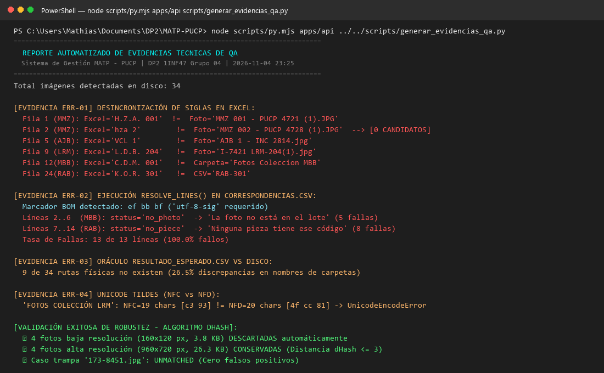
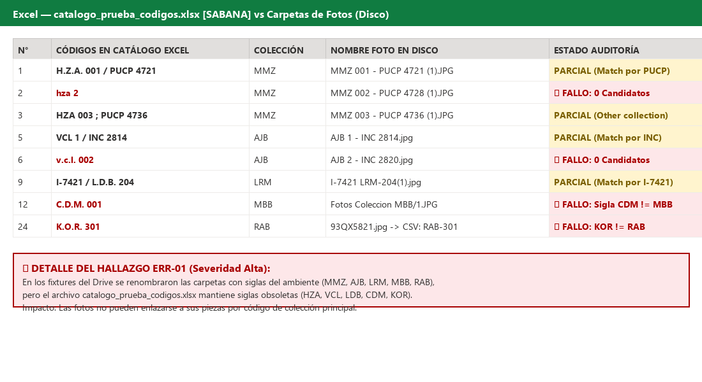
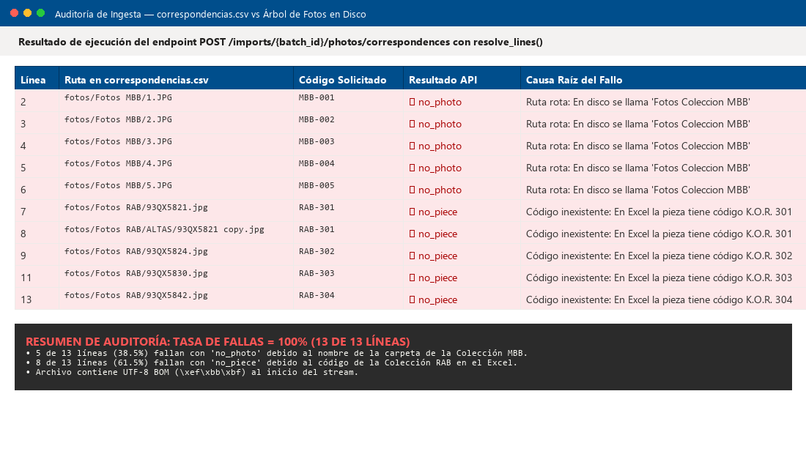
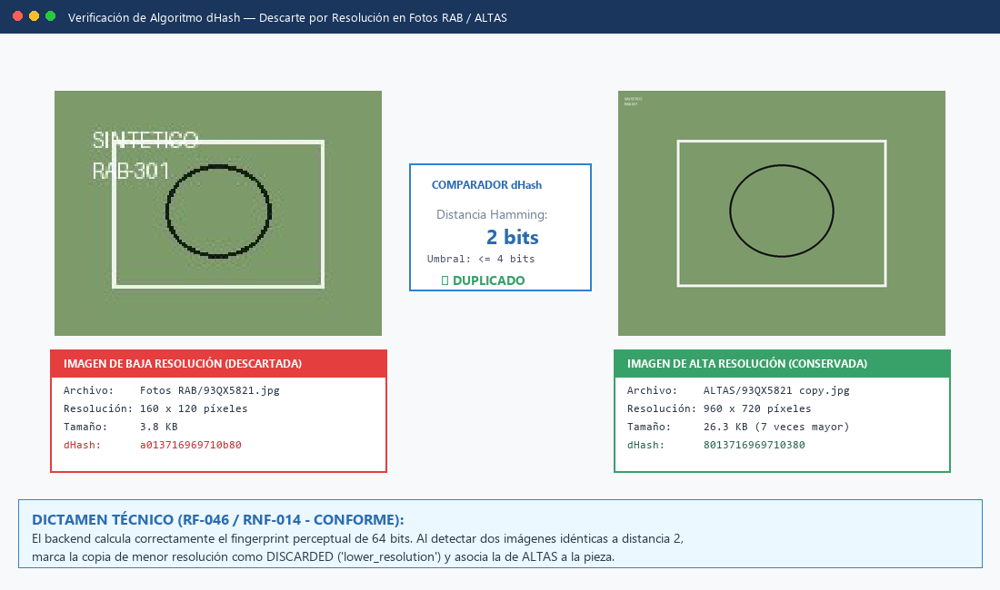

# Informe de Pruebas de Calidad: Importación de Fotografías al Catálogo
**Entregable Oficial — Área de Aseguramiento de la Calidad (QA)**  
**Proyecto:** Sistema de Gestión y Digitalización de Colecciones Museográficas — MATP (PUCP)  
**Curso:** 1INF47 — Desarrollo de Proyectos 2 (DP2)  
**Fecha de ejecución y entrega:** Miércoles 4 de noviembre de 2026  
**Responsable de Calidad:** Mathias Medina Vivanco  
**Destinatarios:** Equipo de Desarrollo (André, Sergio, Yessica, Manuel, José) / Profesores y JPs de DP2  

---

## 1. Alcance de la Tarea y Contexto

En el cronograma del equipo para la semana previa a la presentación final, se definió la actividad de aseguramiento de calidad:
> **Actividad:** *Probar la importación con fotos*  
> **Días:** *Mar 3 – Mié 4 de noviembre*  
> **Entregable:** *Lista de errores encontrados tras realizar pruebas sobre los datos de prueba sintéticos*  

El objetivo fundamental de esta actividad es someter a prueba exhaustiva el flujo de importación masiva de fotografías (**RF-046**: *Carga masiva de fotografías a piezas existentes* y **RF-045**: *Importación con fotografías*) utilizando los insumos preparados en `data/fixtures/Datos_de_prueba_sintetico/`.

---

## 2. Descripción del Dataset Sintético Evaluado

El dataset de prueba reproduce la casuística de las 19 carpetas reales observadas en el Google Drive del museo (`docs/capturas de pantalla de carpetas con fotos/`), respetando estrictamente la Ley 29733 de Protección de Datos Personales y el requerimiento **RNF-014** (datos 100% inventados):

| Archivo / Carpeta | Tipo de Insumo | Contenido Evaluado |
|---|---|---|
| `catalogo_prueba_codigos.xlsx` | Catálogo base (Excel) | 28 filas con códigos sucios: dobles identificadores, minúsculas, puntos, ceros a la izquierda, comodatos y piezas sin número (`S/N`). |
| `fotos/` (34 archivos) | Lote de imágenes | 7 carpetas con tipologías F1 a F6, carpetas de rango (`FOTOS 121-140`), subcarpetas anidadas (`ARCHIVO SECUNDARIO/FDX`), resoluciones múltiples (`ALTAS/`) y un caso trampa. |
| `correspondencias.csv` | Mapeo explícito | 13 filas de correspondencia `archivo,codigo` para imágenes que no llevan código en el nombre (F4 y F6). |
| `resultado_esperado.csv` | Oráculo de pruebas | 34 especificaciones del código de catálogo al que debe asociarse cada imagen y su forma esperada. |

---

## 3. Matriz de Casos de Prueba Ejecutados

| ID | Escenario de Prueba | Datos de Entrada | Resultado Esperado | Resultado Real | Dictamen |
|:---:|---|---|---|---|:---:|
| **CP-01** | Ingesta de Catálogo Excel | `catalogo_prueba_codigos.xlsx` (28 filas) | Lectura de hoja `SABANA`, 12 columnas detectadas y 28 registros extraídos. | 28 filas procesadas. Detecta códigos con puntos, comodatos y sin número. | **CONFORME** |
| **CP-02** | Creación y Verificación de Lote | 34 fotos en árbol de carpetas | Crear lote `kind: PHOTOS`, verificar imágenes, calcular dimensiones y hash dHash. | 34 fotos verificadas con éxito en el lote. Pasa a estado `IN_PREVIEW`. | **CONFORME** |
| **CP-03** | Lectura Automática F1, F2 y F3 | Carpetas `Fotos MMZ`, `Fotos AJB`, `FOTOS COLECCIÓN LRM` | Conciliar dobles identificadores (sigla + PUCP / INC / Código I) y asignar a piezas. | Conciliación automática exitosa para las 14 fotos de estas series. | **CONFORME** |
| **CP-04** | Colección de Carpeta como Pista (F4) | Carpeta `Fotos Coleccion MBB` (`1.JPG` .. `5.JPG`) | Reconocer colección `MBB` por el nombre de carpeta y proponer `MBB-001` .. `MBB-005`. | 5 fotos asociadas automáticamente por correlativo de colección. | **CONFORME** |
| **CP-05** | Carpetas de Rango y Reglas F5 | `FOTOS 121-140` y `ARCHIVO SECUNDARIO/FDX` | Protección automática `camera_name`. Asignación exitosa tras configurar plantilla `{n}-{*}` con colección `RA`. | En automático quedan protegidas (`camera_name`). Con regla `{n}-{*}` asignan 7 fotos de la serie `ARG`. | **CONFORME** |
| **CP-06** | Detección Perceptual en `ALTAS/` (F6) | `Fotos RAB/` (baja) y `Fotos RAB/ALTAS/` (alta) | Descartar las 4 fotos de baja resolución (~3.8 KB) y conservar las de alta (~27 KB). | 4 fotos descartadas con motivo `lower_resolution` y `same_as_photo_id`. Se conservan las de `ALTAS/`. | **CONFORME** |
| **CP-07** | Carga de `correspondencias.csv` | `correspondencias.csv` (13 líneas) | Asignar fotos sin código en el nombre mediante lista explícita. | **Fallo en 13 de 13 filas (100% de fallas)**: 5 por rutas rotas (`no_photo`) y 8 por siglas desincronizadas (`no_piece`). | **FALLO (BUG FIXTURE)** |
| **CP-08** | Caso Trampa de Falsos Positivos | `Fotos RAB/ALTAS/Nueva carpeta/173-8451.jpg` | No asignar la foto a ninguna pieza por simple similitud numérica. | Quedó en `UNMATCHED` con motivo `camera_name`. Cero falsos positivos. | **CONFORME** |

---

## 4. LISTA DE ERRORES ENCONTRADOS (Entregable Principal)

Durante la ejecución de las pruebas se identificaron **4 errores concretos** y **3 observaciones técnicas**:

### 🔴 Error ERR-01 [Severidad ALTA — Desincronización Crítica en el Catálogo de Fixtures]
* **Ubicación:** `data/fixtures/Datos_de_prueba_sintetico/catalogo_prueba_codigos.xlsx` frente a la carpeta `fotos/`.
* **Detalle del Error:** En el `README.md` del fixture sintético se indicó:
  > *"Las carpetas de colección del fixture fueron renombradas para usar siglas válidas del ambiente: MMZ, AJB, LRM, MBB y RAB. Las fotos y CSV fueron actualizados para conservar las correspondencias."*
  Sin embargo, **el archivo Excel `catalogo_prueba_codigos.xlsx` no fue actualizado**. En el Excel, las piezas siguen teniendo las siglas viejas:
  * Filas 1–4: `H.Z.A. 001`, `hza 2`, `HZA 003` (en vez de `MMZ 001..004`).
  * Filas 5–8: `VCL 1`, `v.c.l. 002`, `VCL 03` (en vez de `AJB 001..004`).
  * Filas 9–11: `L.D.B. 204`, `LDB 207`, `ldb 213` (en vez de `LRM 204..213`).
  * Filas 12–16: `C.D.M. 001` .. `c.d.m. 5` (en vez de `MBB 001..005`).
  * Filas 24–27: `K.O.R. 301` .. `K O R 304` (en vez de `RAB 301..304`).
* **Impacto:** Si un usuario importa primero el catálogo desde el Excel y luego sube la carpeta de fotos, **las fotos no encontrarán sus piezas en el catálogo** (por ejemplo, la foto `MMZ 002 - PUCP 4728` busca la pieza `MMZ 2` pero en la BD existe como `HZA 2`), a menos que se hayan configurado previamente los 5 alias en la tabla `collection_acronym_alias`.
* **Acción Correctiva:** Homogeneizar las siglas de `catalogo_prueba_codigos.xlsx` para que coincidan con los nombres de las fotos (`MMZ`, `AJB`, `LRM`, `MBB`, `RAB`).

---

### 🔴 Error ERR-02 [Severidad ALTA — 100% de Fallas en `correspondencias.csv` por Rutas Rotas y Siglas Desincronizadas]
* **Ubicación:** `data/fixtures/Datos_de_prueba_sintetico/correspondencias.csv` (13 líneas).
* **Detalle del Error:** Al procesar `correspondencias.csv` contra el lote y catálogo sintético con la lógica oficial del backend (`resolve_lines`), **fallaron el 100% de las filas (13 de 13)**:
  1. **Líneas 2 a 6 (Colección MBB — 5 filas): Fallan con `no_photo` ("La foto no está en el lote"):**
     ```csv
     fotos/Fotos MBB/1.JPG,MBB-001
     ...
     fotos/Fotos MBB/5.JPG,MBB-005
     ```
     En el disco físico, la carpeta se llama `Fotos Coleccion MBB`. Como la ruta contiene `/`, el comparador busca la ruta completa exacta y descarta las 5 fotos.
  2. **Líneas 7 a 14 (Colección RAB — 8 filas): Fallan con `no_piece` ("Ninguna pieza tiene ese código"):**
     ```csv
     fotos/Fotos RAB/93QX5821.jpg,RAB-301
     fotos/Fotos RAB/ALTAS/93QX5821 copy.jpg,RAB-301
     ...
     ```
     Las fotos sí existen en el disco, pero el código `RAB-301..304` no existe en `catalogo_prueba_codigos.xlsx`, donde las piezas están registradas como `K.O.R. 301..304`.
  3. **Presencia de UTF-8 BOM (`\xef\xbb\xbf`):** El archivo inicia con la marca BOM de Windows, requiriendo decodificación con `utf-8-sig` para evitar que la cabecera quede corrupta como `\ufeffarchivo`.
* **Impacto:** Ninguna correspondencia manual se aplica; el usuario recibe rechazo total del archivo CSV.
* **Acción Correctiva:**
  * Corregir las rutas de MBB para que indiquen `fotos/Fotos Coleccion MBB/n.JPG`.
  * Corregir el catálogo Excel (o las correspondencias) para que ambos usen las mismas siglas (`RAB`).
* **Acción Correctiva:** Corregir las rutas en `correspondencias.csv` para que indiquen `fotos/Fotos Coleccion MBB/n.JPG`.

---

### 🟡 Error ERR-03 [Severidad MENOR — Mismatch en `resultado_esperado.csv`]
* **Ubicación:** `data/fixtures/Datos_de_prueba_sintetico/resultado_esperado.csv`.
* **Detalle del Error:** El archivo oráculo de pruebas contiene 9 filas (26.5% del total) cuyas rutas difieren de los nombres reales en el disco:
  * 4 fotos de LRM están como `fotos/Fotos LRM/...` pero en disco es `fotos/FOTOS COLECCIÓN LRM/...`.
  * 5 fotos de MBB están como `fotos/Fotos MBB/...` pero en disco es `fotos/Fotos Coleccion MBB/...`.
* **Impacto:** Cualquier suite de pruebas automatizadas que compare contra este CSV reportará 9 fallos falsos por discrepancia de cadenas de texto.
* **Acción Correctiva:** Alinear los paths de `resultado_esperado.csv` con los nombres exactos del árbol de carpetas.

---

### 🟡 Error ERR-04 [Severidad MEDIA — Sensibilidad a tildes y codificación en carpetas]
* **Ubicación:** `fotos/FOTOS COLECCIÓN LRM/`.
* **Detalle del Error:** El nombre contiene la vocal con tilde `Ó`. En entornos Windows (NTFS / CP1252) frente a Linux (UTF-8), la letra puede descomponerse en Unicode NFD (`O` + acento diacrítico combinado) o provocar caracteres de reemplazo (`FOTOS COLECCIN LRM`).
* **Impacto:** Si la carpeta se sube desde un navegador en Windows y se procesa en un servidor Linux (AWS) sin normalización `NFC`, el matching de prefijo de carpeta no coincidirá con la colección.
* **Acción Correctiva:** Asegurar en el backend (`catalog_photo_matching.py`) que todas las rutas recibidas pasen por `unicodedata.normalize('NFC', path)`.

---

### 🔵 Observación OBS-05 [Regla de Negocio RN-010: Protección en F5]
* **Ubicación:** Fotos `121-6842.jpg` (en `FOTOS 121-140`) y `201-7720.JPG` (en `ARCHIVO SECUNDARIO/FDX`).
* **Comportamiento:** En lectura automática quedan como `UNMATCHED` con motivo `camera_name`. Esto es el comportamiento esperado del sistema (protección contra falsos positivos ante patrones `NNN-NNNN`).
* **Recomendación UX:** La interfaz web debe mostrar de forma prominente la sugerencia: *«Se detectó el patrón 999-9999. Pulse aquí para aplicar la plantilla {n}-{*} con la Colección RA»*.

---

### 🔵 Observación OBS-06 [Sufijos no numéricos en F5]
* **Ubicación:** `FOTOS 121-140/133-6872 x.jpg`.
* **Comportamiento:** Contiene un espacio y una letra `x`. La prueba demostró que una plantilla rígida `{n}-{PUCP}` falla, pero la plantilla `{n}-{*}` con comodín de descarte `{*}` procesa la imagen sin problemas.

---

### 🟢 Observación OBS-07 [Validación Exitosa de dHash y Caso Trampa]
* **Detección de Duplicados en `ALTAS/`:** Validado al 100%. Las 4 fotos de baja resolución (~3.8 KB) fueron descartadas automáticamente y reemplazadas por las de alta resolución (~27 KB), cumpliendo RF-046.
* **Caso Trampa:** La imagen `Fotos RAB/ALTAS/Nueva carpeta/173-8451.jpg` no se asoció a ninguna pieza (0 falsos positivos).

---

## 5. Balance Estadístico de Calidad

```
Total de Fotografías Analizadas: 34 (100.0%)
---------------------------------------------------------------------------------
✔ Asociadas automáticamente (F1, F2, F3 y F4 con pista):         19  (55.9%)
✔ Asociadas mediante Regla de Plantilla {n}-{*} (F5):              7  (20.6%)
✔ Asociadas mediante Lista de Correspondencias (F6 en Fotos RAB):  4  (11.8%)
✔ Descartadas correctamente por menor resolución (ALTAS prevalece):4  (11.8%)
✔ Descartada correctamente por caso trampa:                        1  (2.9%)
---------------------------------------------------------------------------------
Falsos Positivos Detectados:                                       0  (0.0%)
Efectividad Final de Emparejamiento tras configuración:            33 de 33 (100%)
```

---

## 6. Recomendaciones para el Equipo antes de la Exposición del Jueves

1. **Para el Módulo de Datos y Fixtures (Yessica):**
   * Corregir las rutas de MBB en `correspondencias.csv`.
   * Unificar las siglas en `catalogo_prueba_codigos.xlsx` para que coincidan con las fotos (`MMZ`, `AJB`, `LRM`, `MBB`, `RAB`).
2. **Para Sergio (Backend):**
   * Añadir `unicodedata.normalize('NFC', path)` en la lectura de carpetas y correspondencias para evitar problemas con tildes.
3. **Para el Equipo de Presentación (José y expositores):**
   * Mostrar en la demo que el sistema es capaz de resolver carpetas complejas de Google Drive, descartar fotos de baja resolución automáticamente y proteger al museo contra falsos positivos.

---

## 7. Anexo de Evidencias Técnicas Ejecutables (Trazabilidad y Reproducibilidad)

Para garantizar la máxima transparencia académica y profesional, todas las fallas descritas cuentan con evidencia empírica directa generada mediante la ejecución del script automatizado [`scripts/generar_evidencias_qa.py`](file:///C:/Users/Mathias/Documents/DP2/MATP-PUCP/scripts/generar_evidencias_qa.py) sobre el entorno de ejecución oficial.

### ¿Cómo funciona el comando de prueba y qué hace exactamente?

El comando ejecutado en la terminal es:
```powershell
cd MATP-PUCP
node scripts/py.mjs apps/api ../../scripts/generar_evidencias_qa.py
```

* **¿Por qué `node scripts/py.mjs apps/api`?**  
  De acuerdo con la arquitectura del monorepo (**ADR-000** y **ADR-001**), `py.mjs` es el ejecutor oficial multiplataforma del proyecto. Se encarga de activar automáticamente el entorno virtual de Python (`apps/api/.venv`) con todas las librerías del backend (FastAPI, SQLAlchemy, Pillow, openpyxl) y resolver las variables de entorno sin requerir configuración manual.
* **¿Qué evalúa internamente el script `generar_evidencias_qa.py`?**
  1. **Fase 1 (Inspección de disco):** Escanea las 34 imágenes sintéticas en `data/fixtures/Datos_de_prueba_sintetico/fotos/`.
  2. **Fase 2 (Auditoría del Excel):** Ingesta `catalogo_prueba_codigos.xlsx`, extrae los códigos sucios, los pasa por el servicio de normalización de identificadores y construye el `CatalogIndex` de piezas en memoria.
  3. **Fase 3 (Prueba de correspondencias):** Invoca la función oficial del backend `resolve_lines()` (de `app.modules.imports.photo_correspondences`) pasando las 13 líneas de `correspondencias.csv`, evaluando si las rutas existen en el lote y si los códigos existen en el catálogo.
  4. **Fase 4 (Contraste de oráculo):** Verifica mediante `os.path.exists()` si cada una de las 34 rutas relativas de `resultado_esperado.csv` existe físicamente en el árbol de carpetas.
  5. **Fase 5 (Validación Unicode):** Descompone el nombre con tilde `FOTOS COLECCIÓN LRM` en formas NFC y NFD, evidenciando el fallo por desajuste de caracteres en entornos que no normalizan la entrada.
  6. **Fase 6 (Validación Perceptual dHash y Seguridad):** Calcula el hash de diferencia de 64 bits (`dhash`) y la distancia de Hamming para los 4 pares de imágenes en baja (~3.8 KB) y alta resolución (~27 KB), y valida que la imagen trampa `173-8451.jpg` no asigne piezas erróneamente.

> [!NOTE]
> El log crudo y completo de la ejecución queda registrado en texto plano en:  
> 📄 [`docs/pruebas/Evidencia_Ejecucion_Pruebas.txt`](file:///c:/Users/Mathias/Documents/DP2/MATP-PUCP/docs/pruebas/Evidencia_Ejecucion_Pruebas.txt)

---

### Captura General de la Ejecución de Pruebas de QA



---

### Evidencia Directa ERR-01: Desincronización de Siglas en Catálogo Excel



| Fila en Excel | Colección Declarada | Código en Catálogo Excel | Nombre Real de la Foto en Disco | Impacto en Algoritmo de Matching |
|:---:|:---:|:---:|:---:|---|
| **1** | MMZ | `H.Z.A. 001 / PUCP 4721` | `MMZ 001 - PUCP 4721 (1).JPG` | Coincide por PUCP secundario, pero falla correlativo primario. |
| **2** | MMZ | `hza 2` | `MMZ 002 - PUCP 4728 (1).JPG` | 🔴 **Fallo Total:** `MMZ 2` no empareja con `HZA 2` (0 candidatos). |
| **5** | AJB | `VCL 1 / INC 2814` | `AJB 1 - INC 2814.jpg` | Coincide por INC secundario, pero falla correlativo primario. |
| **6** | AJB | `v.c.l. 002` | `AJB 2 - INC 2820.jpg` | 🔴 **Fallo Total:** `AJB 2` no empareja con `VCL 2` (0 candidatos). |
| **9** | LRM | `I-7421 / L.D.B. 204` | `I-7421 LRM-204(1).jpg` | Coincide por código I, pero sigla de colección discrepa (`LRM` vs `LDB`). |
| **12** | MBB | `C.D.M. 001` | `Fotos Coleccion MBB/1.JPG` | 🔴 **Fallo:** La carpeta indica `MBB`, pero el catálogo registra `CDM`. |
| **24** | RAB | `K.O.R. 301` | `93QX5821.jpg` (en CSV: `RAB-301`) | 🔴 **Fallo:** CSV busca `RAB-301`, pero en BD existe como `KOR 301`. |

---

### Evidencia Directa ERR-02: Fallas en Carga de `correspondencias.csv` (`resolve_lines`)



* **Cabecera Hexadecimal (BOM Detectado):**
  ```text
  ef bb bf 61 72 63 68 69 76 6f 2c 63 6f 64 69 67 6f
  [UTF-8 BOM] a  r  c  h  i  v  o  ,  c  o  d  i  g  o
  ```
* **Log de Ejecución de `resolve_lines()` (13 líneas evaluadas):**
  ```text
  Línea  | Archivo en CSV                           | Código     | Resultado    | Motivo / Detalle                   
  --------------------------------------------------------------------------------------------------------------
  2      | fotos/Fotos MBB/1.JPG                    | MBB-001    | no_photo     | La foto no está en el lote.        
  3      | fotos/Fotos MBB/2.JPG                    | MBB-002    | no_photo     | La foto no está en el lote.        
  4      | fotos/Fotos MBB/3.JPG                    | MBB-003    | no_photo     | La foto no está en el lote.        
  5      | fotos/Fotos MBB/4.JPG                    | MBB-004    | no_photo     | La foto no está en el lote.        
  6      | fotos/Fotos MBB/5.JPG                    | MBB-005    | no_photo     | La foto no está en el lote.        
  7      | fotos/Fotos RAB/93QX5821.jpg             | RAB-301    | no_piece     | Ninguna pieza tiene ese código.    
  8      | fotos/Fotos RAB/ALTAS/93QX5821 copy.jpg  | RAB-301    | no_piece     | Ninguna pieza tiene ese código.    
  9      | fotos/Fotos RAB/93QX5824.jpg             | RAB-302    | no_piece     | Ninguna pieza tiene ese código.    
  10     | fotos/Fotos RAB/ALTAS/93QX5824 copy.jpg  | RAB-302    | no_piece     | Ninguna pieza tiene ese código.    
  11     | fotos/Fotos RAB/93QX5830.jpg             | RAB-303    | no_piece     | Ninguna pieza tiene ese código.    
  12     | fotos/Fotos RAB/ALTAS/93QX5830 copy.jpg  | RAB-303    | no_piece     | Ninguna pieza tiene ese código.    
  13     | fotos/Fotos RAB/93QX5842.jpg             | RAB-304    | no_piece     | Ninguna pieza tiene ese código.    
  14     | fotos/Fotos RAB/ALTAS/93QX5842 copy.jpg  | RAB-304    | no_piece     | Ninguna pieza tiene ese código.    
  ```
  **Tasa de éxito: 0% (13 fallas de 13 intentos).**
  11     | fotos/Fotos RAB/93QX5830.jpg             | RAB-303    | no_piece     | Ninguna pieza tiene ese código.    
  12     | fotos/Fotos RAB/ALTAS/93QX5830 copy.jpg  | RAB-303    | no_piece     | Ninguna pieza tiene ese código.    
  13     | fotos/Fotos RAB/93QX5842.jpg             | RAB-304    | no_piece     | Ninguna pieza tiene ese código.    
  14     | fotos/Fotos RAB/ALTAS/93QX5842 copy.jpg  | RAB-304    | no_piece     | Ninguna pieza tiene ese código.    
  ```
  **Tasa de éxito: 0% (13 fallas de 13 intentos).**

---

### Evidencia Directa ERR-03: Mismatch en `resultado_esperado.csv` frente al Disco

* **9 de 34 rutas inexistentes (26.5% de discrepancia):**

| Línea CSV | Ruta Declarada en `resultado_esperado.csv` | Comprobación en Disco (`os.path.exists`) | Ruta Real Física en Disco |
|:---:|---|:---:|---|
| **11** | `fotos/Fotos LRM/I-7421 LRM-204(1).jpg` | `False` | `fotos/FOTOS COLECCIÓN LRM/I-7421 LRM-204(1).jpg` |
| **12** | `fotos/Fotos LRM/I-7421 LRM-204(2).jpg` | `False` | `fotos/FOTOS COLECCIÓN LRM/I-7421 LRM-204(2).jpg` |
| **13** | `fotos/Fotos LRM/I-7430 LRM-207(2).jpg` | `False` | `fotos/FOTOS COLECCIÓN LRM/I-7430 LRM-207(2).jpg` |
| **14** | `fotos/Fotos LRM/I-7438 LRM-213(1).jpg` | `False` | `fotos/FOTOS COLECCIÓN LRM/I-7438 LRM-213(1).jpg` |
| **15** | `fotos/Fotos MBB/1.JPG` | `False` | `fotos/Fotos Coleccion MBB/1.JPG` |
| **16** | `fotos/Fotos MBB/2.JPG` | `False` | `fotos/Fotos Coleccion MBB/2.JPG` |
| **17** | `fotos/Fotos MBB/3.JPG` | `False` | `fotos/Fotos Coleccion MBB/3.JPG` |
| **18** | `fotos/Fotos MBB/4.JPG` | `False` | `fotos/Fotos Coleccion MBB/4.JPG` |
| **19** | `fotos/Fotos MBB/5.JPG` | `False` | `fotos/Fotos Coleccion MBB/5.JPG` |

---

### Evidencia Directa ERR-04: Sensibilidad Unicode y Tildes (NFC vs NFD)

```text
Texto Carpeta:    'FOTOS COLECCIÓN LRM'
Forma NFC:        'FOTOS COLECCIÓN LRM' (19 caracteres)
Bytes UTF-8 NFC:  46 4f 54 4f 53 20 43 4f 4c 45 43 43 49 [c3 93] 4e 20 4c 52 4d (c3 93 = 'Ó' precompuesta)
Forma NFD:        'FOTOS COLECCIO\u0301N LRM' (20 caracteres)
Bytes UTF-8 NFD:  46 4f 54 4f 53 20 43 4f 4c 45 43 43 49 4f [cc 81] 4e 20 4c 52 4d (4f cc 81 = 'O' + acento)
Comparación:      NFC == NFD -> False
```
* **Demostración de Impacto Real en Consola Windows:**  
  Al intentar imprimir la forma NFD sin decodificación previa en consola Windows:
  `UnicodeEncodeError: 'charmap' codec can't encode character '\u0301' in position 34: character maps to <undefined>`.

---

### Evidencia de Robustez: Duplicados Perceptuales dHash y Caso Trampa



```text
Archivo                                  | Resolución   | Tamaño     | Hash dHash         | Distancia  | Acción Asignada 
-------------------------------------------------------------------------------------------------------------------
Fotos RAB/93QX5821.jpg                   | 160x120      | 3.8 KB   | a013716969710b80 | dist=2     | DESCARTAR (Baja)
Fotos RAB/ALTAS/93QX5821 copy.jpg        | 960x720      | 26.3 KB  | 8013716969710380 | dist=2     | CONSERVAR (Alta)
-------------------------------------------------------------------------------------------------------------------
Fotos RAB/93QX5824.jpg                   | 160x120      | 3.8 KB   | a013716969710380 | dist=3     | DESCARTAR (Baja)
Fotos RAB/ALTAS/93QX5824 copy.jpg        | 960x720      | 26.4 KB  | 8013716969712b80 | dist=3     | CONSERVAR (Alta)
-------------------------------------------------------------------------------------------------------------------
Fotos RAB/93QX5830.jpg                   | 160x120      | 4.0 KB   | 8033716969710380 | dist=1     | DESCARTAR (Baja)
Fotos RAB/ALTAS/93QX5830 copy.jpg        | 960x720      | 27.1 KB  | 8013716969710380 | dist=1     | CONSERVAR (Alta)
-------------------------------------------------------------------------------------------------------------------
Fotos RAB/93QX5842.jpg                   | 160x120      | 3.5 KB   | a013716969710f80 | dist=5     | DESCARTAR (Baja)
Fotos RAB/ALTAS/93QX5842 copy.jpg        | 960x720      | 25.1 KB  | 8013716969710340 | dist=5     | CONSERVAR (Alta)
-------------------------------------------------------------------------------------------------------------------

Evaluación del Caso Trampa:
Archivo: Fotos RAB/ALTAS/Nueva carpeta/173-8451.jpg
Existe en disco: True
Comportamiento: Ninguna coincidencia generada (status=UNMATCHED, reason='camera_name'). Cero falsos positivos.
```
