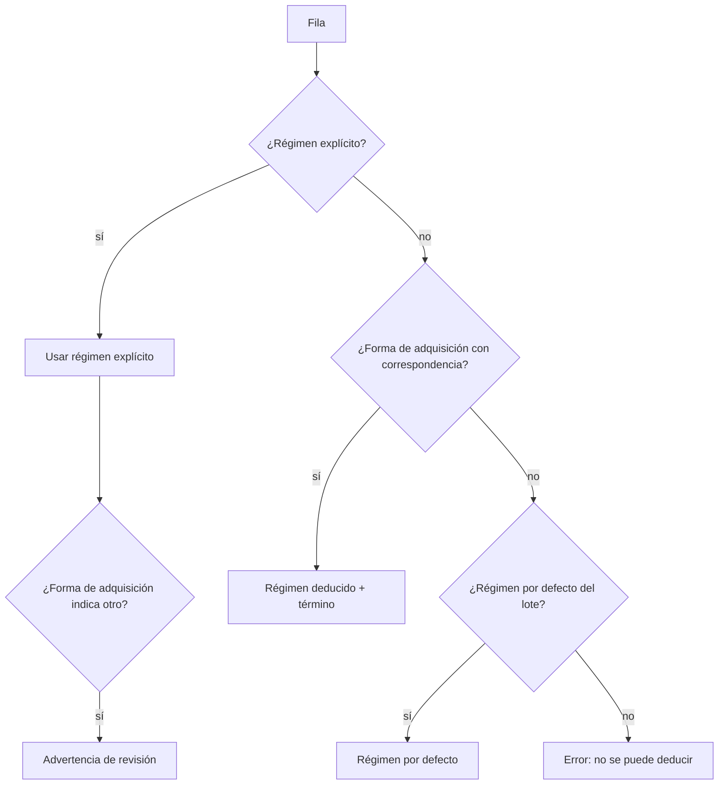

## Context

- `TENURE_ALIASES` (`imports/mapping.py`) es un diccionario fijo: etiquetas del contrato (`Propiedad`, `Comodato`, `Préstamo Temporal`) más `propiedad`, `propio`, `comodato` y `prestamo temporal`. Se usa al convertir el régimen por defecto del lote y el valor de la columna mapeada a `tenure_regime`.
- `Piece.acquisition_method_term_id` existe y la importación admite destinos `terms:<VOCABULARIO>`. Falta confirmar que un destino `terms:ACQUISITION_METHOD` llene ese campo al aplicar (tarea 1.1).
- `normalize_inc_code` acepta 4 y 6 dígitos (`FORMAT_INC_4`, `FORMAT_INC_6`); cualquier otra longitud es «no normalizable».
- `normalization_setting` ya guarda parámetros administrables (`absence_markers`, `concatenation_separators`) con su pantalla «Lectura de códigos».

## Goals / Non-Goals

**Goals:** importar las sábanas reales sin que la forma de adquisición rompa el régimen; reconocer los RN de 5 dígitos.

**Non-Goals:** régimen nuevo; renormalizar en masa identificadores ya registrados (se hace con la vista previa de «Tipos de código»).

## Decisions

### D1. Correspondencias en `normalization_setting` con clave `tenure_aliases`

- Valor: `{"<valor plegado>": "OWNED|LOAN_FOR_USE|TEMPORARY_LOAN"}`. Migración de datos que siembra los valores por defecto (de la propuesta) más los alias actuales; `TENURE_ALIASES` queda como respaldo si la fila no existe (instalación sin migrar).
- Lectura con el mismo caché por petición que los demás parámetros (`NormalizationParams`). Validación al guardar: régimen dentro del enumerado; clave no vacía.
- *Alternativa*: un campo «régimen» en cada término del vocabulario «Formas de adquisición». Más elegante, pero cambia el modelo de términos y la pantalla de Listas de valores de otro change; se descarta para no tocar el contrato.

### D2. Deducción en la conversión de la fila

Las reglas de comodato (RN-003, RN-008) se aplican después sobre el régimen resultante, sin cambios.

Decisiones tomadas al implementar (tareas 1.1 y 1.3):

- **Advertencias que no bloquean**: `MappedRow.warnings` se guarda en `mapped_data["warnings"]` (la API ya devuelve `mapped_data`, así que no cambia el contrato) y la revisión de la importación las muestra en amarillo. La primera es `acquisition_regime_mismatch`.
- **El régimen por defecto del lote sigue siendo una elección cerrada** (etiquetas del contrato y «propio»): una forma de adquisición como «Custodia» solo da un régimen dentro de una fila, mediante `tenure_aliases`. Las etiquetas del contrato se reconocen siempre, aunque el Administrador las quite de la tabla.
- **La forma de adquisición llega a la ficha**: una columna `terms:ACQUISITION_METHOD` guarda el código del término en `mapped_data["acquisition_method"]`; al aplicar se resuelve a `acquisition_method_term_id` y, en una fila de actualización, aparece como el cambio «Forma de adquisición».
- **Sin error duplicado**: si una fila ya tiene un error del régimen (inválido o no deducible), la clasificación no agrega además «Falta el régimen de tenencia».

### D3. RN de 5 dígitos

`FORMAT_INC_5 = "INC_5_DIGITOS"`, una rama más en `normalize_inc_code`. No se rellena con ceros. Los identificadores ya registrados como «no normalizables» con 5 dígitos se recuperan desde «Tipos de código» con la vista previa y confirmación existentes (sin migración automática, RN-005). Para eso, confirmar la vista previa con la **misma** regla y un `confirm_token` válido también recalcula (antes solo lo hacía un cambio de regla; decisión tomada al implementar la tarea 2.2).

## Risks / Trade-offs

- **[SUPUESTO] Donación/Compra → Propiedad** podría no valer para alguna colección. → Correspondencias editables; el régimen por defecto del lote sigue disponible.
- **RN de 5 dígitos que en realidad son 6 sin un cero** → no se rellena; si A4 dice lo contrario, basta cambiar la regla y renormalizar con vista previa.

## Migration Plan

1. Migración de datos `0018_tenure_aliases`: fila `tenure_aliases` en `normalization_setting` (se respeta una fila activa existente) y términos «Cesión de uso» y «Custodia» en «Formas de adquisición» de las instalaciones ya sembradas. `downgrade` quita solo la fila que insertó y conserva los términos, que las piezas pueden estar usando.
2. Seed: los mismos términos para las instalaciones nuevas.
