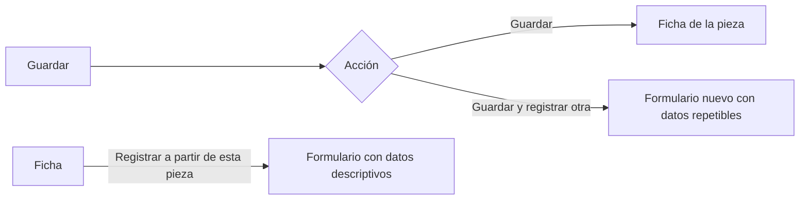

## Context

- API existente: `POST/PATCH/DELETE /collections…` (retiro lógico con motivo, impedido con piezas), `POST/PATCH/DELETE /vocabularies/{code}/terms…`, `POST/PUT /locations…`, CRUD completo de piezas con restauración.
- Frontend: `lib/data/admin.ts` tiene `createCollection` pero no editar ni retirar colecciones, y `createTerm`/`setTermActive` pero no editar la etiqueta. `LocationsAdmin.tsx` crea, edita y desactiva lugares. El formulario de pieza (`components/domain/PieceForm.tsx`) empieza siempre vacío.
- `PUT /locations/{id}` permite desactivar un lugar sin comprobar si tiene piezas.
- Falta comprobar si existe una operación para **restaurar** una colección retirada y si el listado admite incluir retiradas (tarea 1.1).

## Goals / Non-Goals

**Goals:** que el museo pueda mantener a mano todo lo que registra a diario sin pedir ayuda técnica; un mismo patrón en todas las listas.

**Non-Goals:** préstamos y exposiciones (otro change); edición masiva; cambiar reglas de negocio.

## Decisions

### D1. Componente común `AdminList`

Tabla con buscador, «Agregar», acciones por fila («Editar», «Retirar» o «Desactivar»), filtro «Ver retiradas» con «Restaurar», y un `AdminDialog` común (título, campos, errores junto al campo, motivo obligatorio al retirar). Se usa en Colecciones y Listas de valores; Ubicaciones conserva su árbol pero usa el mismo diálogo.

### D2. Restauración de colecciones

Si no existe, `POST /collections/{id}/restore` con motivo, que reutiliza `SoftDeleteMixin` y la auditoría, y `GET /collections?include_retired=true`. Al cambiar una sigla, el diálogo ofrece guardarla como sigla histórica (`POST /collection-acronym-aliases`, ya existe), para que las importaciones y el emparejamiento de fotos la sigan reconociendo.

### D3. Lugares desde el árbol de la búsqueda

El `LocationTreeSelect` de `fusion-busqueda-deposito` recibe acciones opcionales («Agregar lugar aquí», «Editar», «Desactivar») que se muestran con `locations.manage` y abren el mismo diálogo de `LocationsAdmin`. El tipo propuesto sale de la tabla de padres permitidos (`ALLOWED_PARENT` en `locations/hierarchy.py`), que hoy el cliente no conoce: el árbol de ubicaciones suma `allowed_child_types` por nodo.

Hoy desactivar un lugar no comprueba si tiene piezas o lugares activos dentro; se añade esa comprobación en el servicio de ubicaciones (`409 location_in_use` con los conteos), y vale también para Administración.

### D4. Registro continuo de piezas

- Todo en el cliente: los datos se pasan al formulario nuevo como valores iniciales (estado de navegación, no en la URL, para no exponer datos sensibles como el comodante). No hay operación nueva en la API.
- Campos repetibles: `collection_id`, `tenure_regime`, `acquisition_method_term_id`, `entry_date`, `recorded_by`, ubicación inicial, y `lender_name`/`loan_agreement_ref` si es comodato. Campos descriptivos copiables: además, denominación, autor, procedencia, época, tipo de bien, categoría, materiales, técnicas, medidas, descripción, observaciones.
- Nunca se copian: identificadores, fotos, movimientos, evaluaciones, valorizaciones, piezas hijas.
- Antes de mostrar el formulario se revalidan los términos y la colección copiados (pueden haberse retirado).

## Risks / Trade-offs

- **Copiar datos que no corresponden a la pieza nueva.** → Aviso visible «Datos copiados de…», campos copiados resaltados hasta que se tocan.
- **Cambiar una sigla rompe la lectura de códigos históricos.** → Ofrecer guardarla como sigla histórica (D2).

## Migration Plan

Sin migración de datos.
