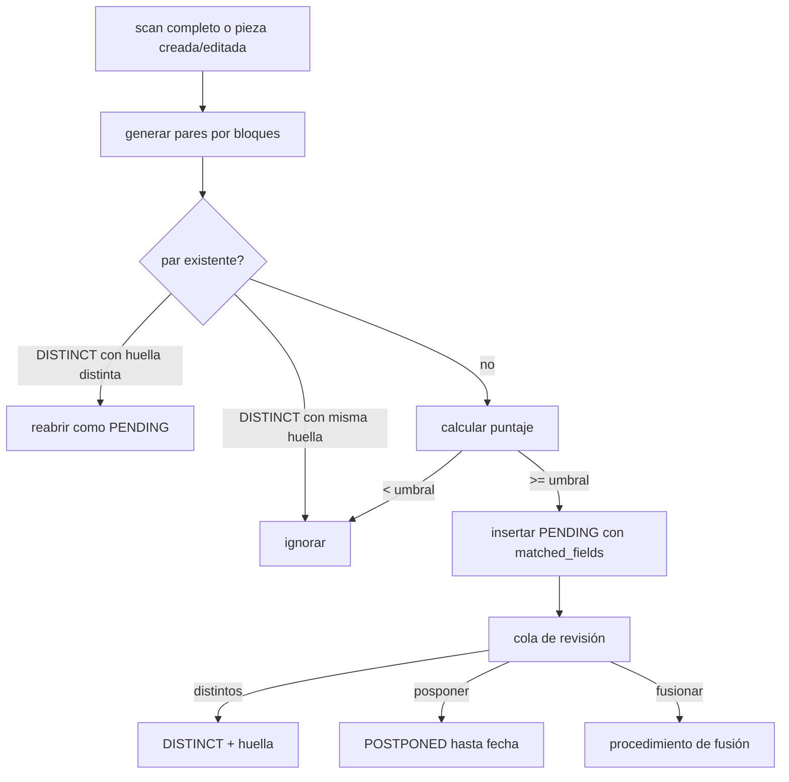

## Context

- `duplicate_candidate`: `piece_a_id`, `piece_b_id` o `import_row_id`, `score` (0–1), `matched_fields`, `status` (`DuplicateStatus`), `compared_fingerprint`, `detected_by`, revisor, nota. `piece.merged_into_id` existe.
- `pg_trgm` e índices GIN de trigramas creados en `0001_core_data_model`.
- Permiso `duplicates.resolve` (Gestor de colecciones, Administrador) [SUPUESTO B7]; la fusión afecta identificadores y fotos de dos piezas.

## Goals / Non-Goals

**Goals:**
- Sospechas explicables (qué campos y por qué) y ajustables sin código.
- Detección completa de 20 000 piezas en minutos, no horas, sin comparar todos contra todos.
- Fusión segura, auditada y reversible que respeta RN-002/RN-003.

**Non-Goals:**
- Aprendizaje automático o embeddings.
- Resolución automática sin humano.

## Decisions

### D1. Generación de candidatos por bloques (blocking) y puntaje
Comparar todos contra todos (≈2·10⁸ pares) no es viable. Se generan pares candidatos por bloques:
1. Mismo valor normalizado de cualquier identificador (vigente o histórico) en piezas distintas.
2. Similitud de trigramas de `denomination` ≥ 0.45 dentro de la misma colección raíz o piezas sueltas. La similitud sigue la definición de `pg_trgm` (trigramas compartidos sobre el total), pero se calcula en Python con un índice invertido por grupo (`quality/scoring.py` y `quality/duplicates.py`): un solo camino de código para PostgreSQL y para las pruebas en SQLite. Si la prueba de volumen (tarea 5.1) lo exige, el bloque puede pasar a `%` de `pg_trgm` con `set_limit` sin cambiar el puntaje.
3. Mismo autor normalizado + procedencia normalizada + similitud de título ≥ 0.3.

Puntaje ponderado (pesos en `quality_setting`, auditados) [SUPUESTO]:

| Señal | Peso |
|---|---|
| identificador normalizado igual, del mismo tipo: código I | 0.45 |
| identificador normalizado igual, del mismo tipo: colección, INC/RN, PUCP, propietario u otro | 0.35 |
| similitud de denominación | 0.30 |
| misma colección (o subcolección) | 0.10 |
| autor / procedencia similares | 0.15 |
| épocas estructuradas superpuestas | 0.10 |
| medidas estructuradas compatibles (±5 %) | 0.10 |

Umbral de cola `DUPLICATE_MIN_SCORE=0.6`. `matched_fields` guarda cada señal con valores comparados. Contradicciones fuertes (dos códigos I vigentes distintos) no descartan el par pero se marcan `blocking_conflict` (la fusión queda bloqueada).

Reglas del puntaje (decididas al implementar la tarea 2.1, 2026-10-19):
- El puntaje es la suma de `peso × similitud` de las señales que aplican, con tope 1. Una señal aplica solo si ambas piezas tienen el dato; un dato ausente no suma ni resta.
- **Un par que comparte un identificador normalizado entra siempre en la cola**, aunque su puntaje quede bajo el umbral: con los pesos de la tabla, un código compartido con denominaciones distintas puede quedar bajo 0.6 cuando las demás señales no coinciden, y la spec exige que ese par llegue a revisión (escenario «Mismo código histórico en dos piezas»). El puntaje mostrado sigue siendo el real. El umbral solo filtra los pares de los bloques 2 y 3.
- **Pesos reequilibrados (2026-10-19, al implementar la tarea 2.4).** Con los pesos iniciales (denominación 0.25, colección 0.10, autor/procedencia 0.10, época 0.05, medidas 0.05), un par sin identificador compartido sumaba como máximo 0.55, por debajo del umbral 0.6: los bloques 2 y 3 nunca podían meter un par en la cola y el escenario «Detección incremental al editar» era imposible. Medido sobre el seed (298 piezas, 1 508 pares evaluados sin identificador compartido), bajar el umbral no era una alternativa: con 0.35 entraban 1 060 pares y con 0.45, 94; una regla de «denominación casi igual en la misma colección» metía 832, porque piezas distintas comparten denominación («Retablo ayacuchano»). Con los pesos actuales un par sin identificador llega como máximo a 0.75 y solo entra si coinciden varias señales (denominación, colección, autor y procedencia, época): en el seed entraban 10 pares de esos 1 508 (7 tras la regla siguiente), y los 10 pares sembrados siguen detectándose (puntajes de 0.80 a 0.90). Una denominación casi igual en la misma colección suma 0.40 por sí sola, así que no basta. Los identificadores y el umbral no cambian.
- **Autor anónimo o desconocido = autor ausente** [SUPUESTO] (2026-10-19). «Anónimo», «Autor anónimo», «Desconocido», «No presenta» (pregunta L7), «sin autor» y los marcadores de «sin código» de la pregunta A5 no cuentan como autor: no suman en la señal de autor y procedencia, no forman el bloque 3 ni entran en la huella. Que dos piezas sean de «Anónimo» no las hace parecidas; con esta regla dejaron de entrar 3 de los 10 pares nuevos del seed («Retablo costumbrista» y «San Isidro Labrador», de procedencias distintas). La lista se registra con los demás supuestos en la tarea 5.4.
- Los pesos, el umbral, la tolerancia de medidas y los mínimos de los bloques se leen de `quality_setting` (clave `duplicates.scoring`); sin fila, rigen los valores por defecto de esta tabla.

### D2. Huella de comparación
`compared_fingerprint` = SHA-256 de los valores normalizados de los campos comparados de ambas piezas (ordenados por ID de pieza). Un par `DISTINCT` solo se reabre si la huella cambia (RF-030 "no vuelve a proponerse mientras los datos comparados no cambien").

### D3. Ejecución
- `POST /quality/duplicates/scan` (Administrador/Gestor) corre en `BackgroundTasks` con registro en tabla `quality_job` (estado, conteos, duración); un solo scan activo a la vez (`409 scan_in_progress`).
- Incremental: al confirmar la transacción de alta/edición de pieza o identificador se encola la pieza en `quality_job_item` y un worker en proceso la procesa (bloques 1–3 solo para esa pieza). Si falla, el siguiente scan completo lo recupera.
- `SimilarityScorer.score(subject: PieceProfile) -> list[Candidate]` expone los mismos bloques y pesos para `importacion-pipeline-reconciliacion`: el pipeline construye un `PieceProfile` con `piece_id=None` a partir de la fila mapeada (denominación, colección, autor, procedencia, época, medidas e identificadores normalizados) y recibe las piezas que entran en la cola con esa fila, de mayor a menor puntaje. La implementación es `RuleBasedSimilarityScorer` en `quality/duplicates.py`.

### D4. Fusión
`POST /quality/duplicates/{candidate_id}/resolve` con `{resolution: "MERGED", surviving_piece_id, field_choices, note}`, siguiendo el esquema `DuplicateResolution` del contrato. `note` es el motivo y es obligatorio al fusionar. `field_choices` es el único campo añadido al contrato: lo exige la spec («elige… el valor de cada campo en conflicto»). Es un objeto `{campo: "SURVIVING" | "ABSORBED"}` limitado a los campos editables de la ficha. Todo ocurre en una transacción:
1. Validaciones:
   - el par debe ser de dos piezas del catálogo y `surviving_piece_id` una de ellas (422);
   - ambas activas y no fusionadas (`409 stale_candidate`, como en la tarea 3.2);
   - regímenes distintos: `409 merge_blocked_tenure`;
   - códigos I vigentes distintos: `409 merge_blocked_inventory_code` (usar la corrección de código I);
   - **si solo una pieza tiene código I vigente, esa debe ser la conservada** (`409 merge_surviving_must_hold_inventory_code`). Así ningún código I cambia de pieza y RN-002 queda intacto (decisión del 2026-10-20).
2. Campos de la ficha: el valor elegido en `field_choices`. Sin elección, queda el de la conservada, y si está vacío se completa con el de la absorbida.
3. Identificadores de la absorbida:
   - pasan a la conservada;
   - los que repiten un valor normalizado de la conservada quedan como **no vigentes**, con nota «fusión» (nunca se borran);
   - los códigos I bloqueados no se mueven: quedan en la absorbida y se ven por el enlace (paso 1).
4. Pasan también a la conservada (decisión del 2026-10-20):
   - **fotografías** (si la conservada tiene portada, la de la absorbida queda como foto normal);
   - **componentes** (piezas hijas);
   - **materiales** (unión sin repetir; los repetidos se quedan en la absorbida);
   - **préstamos** (salvo que la conservada ya esté en el mismo préstamo);
   - **sugerencias de IA**.
5. **Movimientos, datos de origen y evaluaciones de conservación no se trasladan**: sus tablas son de solo inserción (la base rechaza `UPDATE`). Se quedan en la absorbida, intactos, y la conservada los muestra a través de `merged_into` (decisión del 2026-10-20).
6. Pieza absorbida: `merged_into_id = surviving` y baja lógica con motivo «Fusionada en <id>: <note>». Su ficha devuelve `merged_into` (pieza, fecha y motivo) para redirigir (tarea 3.4).
7. El par queda `MERGED` y los demás candidatos de la pieza absorbida pasan a `SUPERSEDED`. Los de la conservada no se tocan: siguen siendo comparaciones válidas y la detección incremental los vuelve a evaluar.
8. **Un único conjunto de cambios.** `AuditContext` admite un `change_set_id` fijo, de modo que todos los `flush` de la fusión comparten uno y la acción registrada es `MERGE`. El par guarda ese `change_set_id` para que `auditoria-y-soft-delete-transversal` pueda revertir la fusión.

### D5. Posponer
`POST /quality/duplicates/{candidate_id}/resolve` con `{resolution: "POSTPONED", postponed_until, note}`, siguiendo el esquema `DuplicateResolution` del contrato. `postponed_until` es obligatorio, debe ser una fecha futura y no puede superar los 180 días [SUPUESTO]; si no cumple, la API responde 422 con el máximo en `details`. Al vencer, el par vuelve a `PENDING` en la siguiente lectura de la cola (sin cron). Marcar un par como distinto usa el mismo esquema con `resolution: "DISTINCT"` y guarda la huella de los valores actuales (D2).

## Risks / Trade-offs

- **Pesos y umbrales [SUPUESTO]** → configurables y visibles; se calibrarán con la muestra real (A1).
- **Similitud de trigramas diferente en SQLite** → pruebas de lógica con `difflib`; calibración y rendimiento solo válidos en PostgreSQL (tarea con Docker).
- **Fusión incorrecta** → confirmación con comparación lado a lado, auditoría completa y reversión por conjunto de cambios.
- **Worker incremental en proceso** → mismo patrón y limitaciones que el pipeline de importación.
