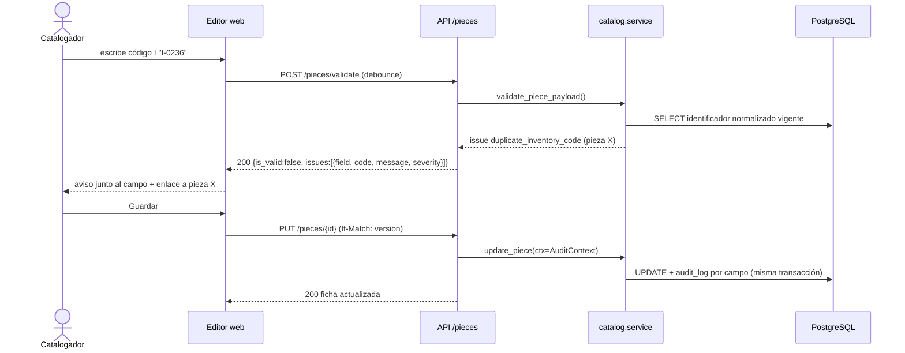

## Context

- El modelo ya existe (`piece`, `piece_identifier`, `identifier_type`, `piece_material`, `audit_log`) con guardas `before_flush`: borrado físico prohibido, código I bloqueado salvo corrección auditada por Administrador, comodato/préstamo temporal sin I, auditoría campo a campo con `AuditContext` obligatorio (ADR-004).
- La API expone lecturas implementadas y los stubs de escritura con esquemas y ejemplos (ADR-005). Las rutas y esquemas no se renombran: solo se reemplaza el stub por la implementación.
- El alta (`POST /pieces`), la edición (`PUT /pieces/{id}`) y la eliminación lógica (`DELETE /pieces/{id}`) ya están implementadas y auditadas desde `contratos-api-borrador`: este change las verifica y las ajusta, no las reescribe. Quedan **cinco** operaciones con `x-change: ficha-pieza-crud`: `/pieces/validate`, `/pieces/{id}/restore`, `/pieces/{id}/identifiers`, `/pieces/{id}/identifiers/{id}/correction` y `/pieces/{id}/children`.
- La capa de servicio ya está: `catalog/service.py` (`create_piece`, `update_piece`, `change_tenure`, `set_parent`) e `identification/service.py` (`add_identifier`, `set_inventory_code`, `correct_locked_identifier`, `retire_identifier`).
- La identidad llega por la sesión del servidor (cookie `matp_session`, ADR-009) y los permisos se leen de la base en cada petición; la cabecera `X-MATP-User` queda para desarrollo y pruebas.
- El normalizador N1–N7 (`app/modules/identification/normalization.py`) es `[SUPUESTO]` y ya tiene ~100 casos de prueba.
- La maqueta tiene editor y ficha en modo mock (`useReducer`), y `lib/data/pieces.ts` ya tipa las lecturas `live`.

## Goals / Non-Goals

**Goals:**
- Alta, edición, eliminación lógica y restauración de piezas completamente auditadas y con las reglas de dominio aplicadas en el servidor.
- Validación idéntica en cliente y servidor (una sola fuente: el servidor).
- Registro de identificadores, corrección del código I y asociación de componentes a un conjunto por la API.
- Editor web conectado a la API real, usable por personas con baja alfabetización digital.

**Non-Goals:**
- Reversión genérica de ediciones (la hace `auditoria-y-soft-delete-transversal`).
- Edición masiva (la cubre la importación).
- Fotos, ubicaciones, alertas, duplicados.

## Decisions

### D1. La validación vive solo en el servidor; el cliente la consulta
`POST /pieces/validate` ejecuta exactamente la misma función `validate_piece_payload()` que usan `POST`/`PUT`, dentro de una transacción que siempre se revierte. El editor la llama con *debounce* (~400 ms) por campo modificado. La función devuelve una lista de `FieldIssue` (`field`, `code`, `message`, `severity`) y la operación responde `200` con `{is_valid, issues[]}`: `is_valid` es `false` cuando hay al menos un issue de `severity` `error`; los issues de `severity` `warning` (formato de código no reconocido, código I de una pieza eliminada, etc.) no bloquean el guardado. Es la forma que ya fijan el esquema `PieceValidationResult`, el contrato y el cliente web.
*Alternativa descartada*: duplicar las reglas en Zod en el cliente → divergencia garantizada con las reglas `[SUPUESTO]` que cambiarán tras la validación con la contraparte. Zod se usa solo para tipos/formato local (campos vacíos, números).

### D2. Concurrencia optimista con `version`
Se añade a `piece` una columna entera `version` (migración Alembic nueva, `server_default 1`) incrementada por SQLAlchemy `version_id_col`. `PUT` exige la cabecera `If-Match` con la versión leída; si no coincide → `409 edit_conflict` con los valores actuales en `details`. Sin `If-Match` → `428 precondition_required`. La ficha expone `version` en la lectura, de modo que el editor pueda enviarla (tarea 4.5).
*Alternativa*: comparar `updated_at` → frágil con precisión de timestamps en SQLite/PostgreSQL.

### D3. Semántica de `PUT`: actualización parcial
El contrato del equipo fija el verbo `PUT /pieces/{id}` (D1 de `alinear-api-endpoints-v1`: el documento manda en la ruta y el verbo, y el comportamiento se conserva). La semántica sigue siendo de actualización parcial por JSON merge (campos ausentes = sin cambio; `null` explícito = vaciar, salvo campos obligatorios). Guardar sin cambios no genera auditoría (ya garantizado por `tracking.py`) y no incrementa `version`.

### D4. Transiciones de régimen de tenencia
Tabla de transiciones en `catalog/tenure.py`:

| Desde → Hasta | Regla |
|---|---|
| propiedad → comodato | rechazada si tiene I vigente (RN-003) |
| comodato → propiedad | requiere `reason` + `supporting_document_ref` y permiso `pieces.update` de Gestor/Administrador [SUPUESTO B3] |
| * → préstamo temporal | rechazada si tiene I o código de colección vigente (RN-004) |
| préstamo temporal → propiedad/comodato | requiere motivo; el número temporal pasa a identificador no vigente |

`legal_owner` se fija a "PUCP" en propiedad y es de solo lectura (RN-006).

El documento de respaldo de la transición **no se modela como columna nueva**: `piece` conserva su estructura y el `supporting_document_ref` viaja en el motivo de la transición y queda en la auditoría junto con el valor anterior y el nuevo. `change_tenure()` deja de exigir motivo en toda transición y lo exige solo en las filas de la tabla que lo necesitan.

### D5. Identificadores concatenados
`POST /pieces/{id}/identifiers` con un valor que el normalizador detecta como concatenado (`I 2362 / RA 28`) responde `422 concatenated_identifier` con `details.proposals`, una entrada por código propuesto con los nombres de campo que ya consume el cliente web: `identifier_type_code`, `original_value` y `normalized_value`. La detección ocurre **antes** de registrar: se comprueba el valor completo con `split_compound()`/`propose_identifiers()` y, solo si hay un único código, se llama a `add_identifier()`. El cliente muestra la propuesta y reenvía **cada** identificador por separado con `confirmed_split: true`. Nunca se separan automáticamente (RF-023).

### D6. Corrección de código I
`POST .../identifiers/{identifier_id}/correction` con `{new_value, reason}`; solo el **Administrador** puede ejecutarla. En una transacción: el identificador actual pasa a `is_current=false`, `replaced_by_id` apunta al nuevo, el nuevo queda `is_locked=true`; auditoría con acción `CORRECTION` y `reason`. Si `new_value` normalizado pertenece a otra pieza (activa o eliminada) → `409` con referencia a esa pieza (A6). El permiso `identifiers.correct_inventory_code` queda solo en el rol Administrador, de modo que el permiso y el rol coinciden y el `403` ocurre en la dependencia de la ruta.

### D7. Eliminación y restauración
`DELETE /pieces/{id}` exige el motivo como **parámetro de consulta** `?reason=` (no vacío), tal como lo define el contrato de interfaces del equipo y lo consume ya el cliente web; usa `soft_delete.py`. `POST /pieces/{id}/restore` exige el rol **Administrador** (permiso `pieces.restore`, restringido al Administrador) y falla con `409` si al restaurar se duplicaría un código I vigente de otra pieza activa,consultando también las piezas eliminadas lógicamente.

### D8. Editor web
Formulario por secciones (Identificación, Descripción, Procedencia y época, Medidas y materiales, Conservación, Observaciones) con etiquetas visibles y botón grande "Guardar". Se adoptan `react-hook-form` + `zod` (ADR-015): `react-hook-form` `^7.90.0` y `zod` `^4.6.7` ya están instaladas en `apps/web`. *Contingencia*: formulario controlado con `useReducer` como en la maqueta. El borrador se guarda en `sessionStorage` antes de enviar para recuperarlo si la sesión expira (RNF-012 escenario "Sesión expirada").

### D9. El alcance son cinco stubs
Este change implementa las cinco operaciones que siguen marcadas con `x-change: ficha-pieza-crud`: `/pieces/validate`, `/pieces/{id}/restore`, `/pieces/{id}/identifiers`, `/pieces/{id}/identifiers/{id}/correction` y `/pieces/{id}/children`. `POST`, `PUT` y `DELETE /pieces` ya están implementadas y auditadas: se **verifican y ajustan** (motivo del borrado por consulta, `version`/`If-Match`, transiciones de tenencia), no se reimplementan. `/pieces/{id}/children` entra en el alcance porque su `x-change` es este y porque cubre RF-009.
*Alternativa descartada*: reescribir el CRUD ya implementado → trabajo sin valor y riesgo de romper la auditoría existente.

## Risks / Trade-offs

- **Reglas `[SUPUESTO]` (A2, A5, A6, B1, B3, B8, B11)** pueden cambiar → se concentran en `tenure.py`, el normalizador y `validate_piece_payload()`, con pruebas que las fijan explícitamente.
- **Migración de `version`** toca la tabla más grande → aditiva, con default; coordinar el orden de migraciones con otros changes (numerar al abrir el PR).
- **`If-Match` obligatorio rompe al cliente actual** → el editor todavía no envía `If-Match` ni expone `version`; la tarea 4.5 lo ajusta antes de que el backend empiece a exigir la precondición.
- **Debounce de validación en conexión lenta (RNF-005)** → el cliente cancela peticiones anteriores (`AbortController`) y nunca bloquea la escritura.
- **Consultas `ilike`/`exists` solo probadas en SQLite** → la tarea de verificación en PostgreSQL es obligatoria cuando Docker esté disponible.

## Open Questions

- Campos obligatorios adicionales (B1) y formato del código derivado de componentes (B8): se implementan como configuración; no bloquean las tareas.
- Réplica del código I y consulta de "incluye eliminadas" en la restauración y la corrección: hay que fijar el criterio único con el resto del dominio antes de escribir las tareas 2.6 y 3.2.
- Dónde vive la tabla de transiciones (`catalog/tenure.py` frente a las reglas ya repartidas en `catalog/service.py` e `identification/service.py`): la tabla debe ser la única fuente y `change_tenure()` debe delegar en ella.
- Identificador de la revisión Alembic que añade `piece.version`: hay revisiones `0002` repetidas, hay que elegir el siguiente id y coordinarlo con los demás changes abiertos.
- Divergencias de esquema con el contrato de interfaces (`version` en la pieza, `confirmed_split` en el alta de identificador): hay que declararlas en `docs/api/mapeo-endpoints-v1.md` y en la lista congelada de `test_contract_conformance.py`.
