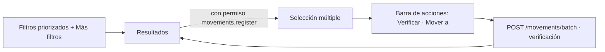

## Context

- `/busqueda` (`app/busqueda/page.tsx` + `components/domain/SearchLive.tsx`, ~630 líneas): panel de filtros (texto, colección, categoría, material, estado, ubicación como lista, régimen, código I, época, completitud), filtros activos como chips, resultados con `PieceCard`, exportación. La API ya acepta `author` y `provenance`, que la UI no muestra.
- `/deposito` (`app/deposito/page.tsx` + `DepositoParts.tsx`, ~640 líneas): búsqueda por texto, ficha de la pieza con «Verificar» y «Mover a» (`DestinationPicker`, solo lugares finales) y «Lote pendiente» para mover varias.
- La búsqueda de texto (`search/filters.py`, `ranking.py`) compara denominación, autor, procedencia, época y términos; no la descripción.

## Goals / Non-Goals

**Goals:** una sola pantalla para encontrar y actuar; filtros en el orden del museo; usable en tableta en el depósito.

**Non-Goals:** cambiar reglas de movimientos o la jerarquía de ubicaciones; incidencias de daño (F5).

## Decisions

### D1. Descripción en la búsqueda

- En `PieceFilter`: parámetro `description` (contiene, sin tildes con `immutable_unaccent`, como los demás textos) y la descripción dentro de la condición OR del texto libre `q`.
- En `ranking.py`: coincidencia solo en la descripción con el peso más bajo de las coincidencias de texto y `matched_fields: ["description"]`.
- Rendimiento (RF-038): la descripción es el campo de texto más largo. Se mide con la prueba de rendimiento reproducible existente (20 000 piezas sintéticas); si supera el umbral, índice trigram (`pg_trgm`) sobre `unaccent(lower(description))` en PostgreSQL. En SQLite no aplica.

### D2. Una vista, dos modos de interacción

- La selección y la barra solo aparecen con el permiso de movimientos (el mismo que hoy exige `/deposito`).
- «Mover a» abre el `DestinationPicker` existente en un panel lateral (escritorio) o en una hoja inferior (tableta). La verificación usa la operación existente, una por pieza seleccionada.
- El «Lote pendiente» del depósito se reemplaza por la selección (la selección **es** el lote); se mantiene entre páginas de resultados y se muestra su conteo.
- Componentes: `SearchFilters` (priorizados + «Más filtros»), `LocationTreeSelect` (árbol con búsqueda, reutiliza `lib/data/locations.ts`), `SelectionBar`. `SearchLive.tsx` se divide para no seguir creciendo.

### D3. Redirección y navegación

`app/deposito/page.tsx` pasa a ser una redirección del lado del cliente a `/busqueda` que conserva el filtro de ubicación si el enlace lo trae (hoy `/deposito` no lee parámetros). Se quita «Depósito» del menú y se añade en la búsqueda un acceso rápido «Ver por ubicación» que abre el árbol.

### D4. Tableta

Por debajo de `lg`: tarjetas compactas con casilla grande, barra de acciones fija abajo, filtros en un panel que se abre con un botón. Se reutilizan las clases de tamaño táctil de `rediseno-ux-deposito`.

## Risks / Trade-offs

- **Seleccionar por error y mover piezas que no correspondían.** → Confirmación con la lista de piezas y su destino antes de mover; cada movimiento queda en el historial y se corrige con otro movimiento.
- **La vista se vuelve pesada.** → «Más filtros» plegado y la barra solo con selección; dividir `SearchLive.tsx`.
- **Rendimiento con la descripción** → D1 (medición e índice trigram si hace falta).

## Migration Plan

Sin migración de datos. Si se añade el índice trigram, migración aditiva solo para PostgreSQL (`CREATE EXTENSION IF NOT EXISTS pg_trgm` ya disponible en la imagen oficial).
