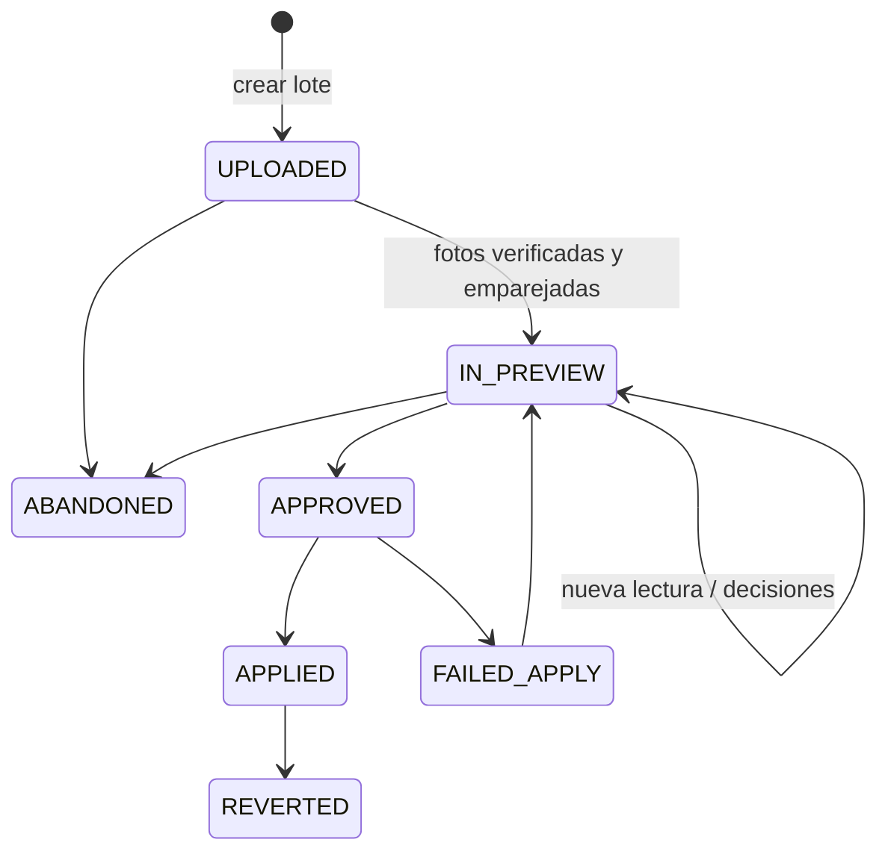

## Context

- `importacion-masiva-fotografias` (activo) ya tiene: tabla `import_photo` con `relative_path`, `original_filename`, huella SHA-256, estado y propuesta de fila (`row_id`, `match_status`, `match_source`, `candidate_row_ids`, `sort_key`); subida reanudable por tandas con URL prefirmadas; verificación y derivados en el worker (`photo_verification.py`); el lector de nombres `photo_matching.read_name`; la ejecución del emparejamiento `photos.match_batch_photos`; la bandeja (`photo_review.py`, solo `assign` por ahora); y la aplicación (`apply._photos_to_apply` → `media.service.register_from_import`), que ya guarda `relative_path` en `media_asset.extra_metadata`.
- Todo eso está atado a **filas** de un lote con Excel. El lote (`import_batch`) exige `file_name` y recorre `UPLOADED → MAPPED → VALIDATED → IN_PREVIEW → APPROVED → APPLIED`.
- **Estructura del archivo fotográfico del museo** (capturas de Drive del 2026-10-31, revisadas solo en su estructura; no se copian al repositorio porque muestran nombres de personas, RNF-014):
  - Carpetas por colección con nombres del tipo `<SIGLA> <nn> - PUCP <nnnn> (2).JPG`.
  - Carpetas de campañas de fotografía (2002–2003) con `NNN-NNNN.jpg` y carpetas genéricas (`CARPETA 1…5`, `FD`, `FD QUE FALTAN`, `Nueva carpeta`) y sus ZIP repetidos.
  - Una carpeta raíz con miniaturas `82LF4169.jpg` (20–40 kB) y una subcarpeta `ALTAS/` con la misma foto en alta (`82LF4169 copy.jpg`, 1–1,5 MB).
- Riesgo detectado en el lector actual: en `175-3554`, el candidato `NUMBER` `3554` se compara con los códigos I, INC/RN y PUCP. Dentro de un lote de 30 filas el riesgo es bajo; contra ≈ 10 000 piezas del catálogo es alto.

## Goals / Non-Goals

**Goals:**
- Cargar el archivo fotográfico histórico a piezas que ya existen, en lotes de miles de fotos, sin falsos positivos.
- Dejar a la persona solo lo que la máquina no puede decidir, y hacerlo rápido (selección múltiple por carpeta).
- Reutilizar al máximo el flujo de fotos del lote con Excel: una sola tabla, una sola bandeja y una sola forma de aplicar y revertir.

**Non-Goals:**
- API de Google Drive, subida de ZIP, reconocimiento de la pieza o de la vista por el contenido de la imagen (IA).
- Crear piezas desde fotos.
- Interpretar el prefijo de `175-3554` mientras el museo no lo explique (AF1).

## Decisions

### D1. El lote de solo fotos es un `import_batch` con `kind = PHOTOS`

- Columna nueva `import_batch.kind` (`SPREADSHEET` por defecto | `PHOTOS`), migración aditiva con valor por defecto para los lotes existentes. Para `PHOTOS`, `file_name` guarda el nombre que el usuario da al lote (p. ej. «Archivo fotográfico — colección ABC») y `file_storage_key` queda vacío.
- Máquina de estados: se añade una tabla de transiciones propia para `PHOTOS`, sin pasos de mapeo ni validación:

  `ensure_transition` elige la tabla por `batch.kind`. `PHOTO_STATES` (estados que admiten fotos) para `PHOTOS` es `{UPLOADED, IN_PREVIEW}`.
- `POST /imports/photo-batches {name}` crea el lote. Las operaciones de subida, listado, resumen, decisiones, aprobación, aplicación y reversión son las mismas de `/imports/{batch_id}/…`; las de Excel (mapeo, validación, filas) responden `409 batch_kind_mismatch` en un lote `PHOTOS`.
- *Alternativa descartada*: una tabla `photo_batch` aparte. Duplicaría la máquina de estados, el worker, la bitácora y la reversión.

### D2. Propuesta de pieza en `import_photo`

Columnas nuevas (migración aditiva):

| Columna | Uso |
|---|---|
| `piece_id` (FK `piece`, nulo) | Pieza propuesta o asignada en un lote `PHOTOS` |
| `candidate_piece_ids` (JSON) | Candidatas de una foto ambigua |
| `match_reason` (`String(60)`) | Motivo legible: `discrepant_codes`, `camera_name`, `template_mismatch`, `bare_number_without_collection`, `other_collection`, `duplicate_name` |
| `width_px`, `height_px` | Para elegir la mayor resolución (D6) |
| `perceptual_hash` (`String(16)`) | dHash de 64 bits en hexadecimal |
| `same_as_photo_id` (FK `import_photo`, nulo) | Foto conservada cuando esta se descartó por ser otra resolución |

Una foto tiene `row_id` (lote con Excel) **o** `piece_id` (lote de fotos), nunca los dos (`CHECK`). `PhotoMatchSource` suma `TEMPLATE` y `LIST`. `PhotoMatchStatus` no cambia.

### D3. Índice del catálogo y resolución

- Índice construido una vez por ejecución: `{(tipo, valor_normalizado) → {piece_id}}` con los `piece_identifier` vigentes (`is_current`, sin borrar) de piezas no retiradas, más `{(COLECCION_NUMERO, n, collection_id) → {piece_id}}` para el correlativo de los códigos de colección. Para ≈ 10 000 piezas y ≈ 3 códigos por pieza son ≈ 30 000 entradas en memoria, aceptable para el worker. Si una carpeta tiene colección como pista (D5), el índice se filtra por esa colección.
- `photo_matching` se divide en dos capas: la lectura del nombre (`read_name`, sin cambios de firma) y la resolución contra un índice genérico `Mapping[key, set[target_id]]`. `match_photos` (filas) y la nueva `match_catalog_photos` (piezas) comparten la resolución por nivel de fuerza del candidato.
- **Orden de vías** en un lote `PHOTOS`: lista de correspondencias (D7) → nombre del archivo según la forma de lectura de su carpeta (D4) → nombre de cada carpeta de la ruta (de la más cercana a la más lejana; solo en modo automático) → sin asignar.
- **Protecciones** (solo contra el catálogo):
  - Candidatos de fuerza `NUMBER` (número suelto dentro de un nombre más largo) y `WHOLE` puramente numéricos se comparan **solo** con `COLECCION_NUMERO` de la colección pista; sin pista → `UNMATCHED` con `bare_number_without_collection`.
  - Patrones de cámara: los de `_CAMERA_RE` más `^\d{3}-\d{4}$` y `^\d{2}[A-Za-z]{2}\d{4}$` aplicados al nombre ya limpio. La lista ampliable vive en `normalization_setting` con la clave `photo_camera_patterns` (lista de expresiones regulares, validadas al guardarlas con `re.compile` y un límite de longitud de 200 caracteres). Estos dos patrones nuevos se aplican también al lote con Excel: en `175-3554` no hay código en ningún caso.
- Una foto cuyo único candidato apunta a una pieza de otra colección que la pista queda `UNMATCHED` con `other_collection` y la pieza en `candidate_piece_ids`, para asignarla con un clic.

### D4. Forma de lectura por carpeta

- `import_batch.photo_reading` (JSON, nulo): `{"default": {"mode": "auto"}, "folders": {"<ruta>": {"mode": "auto|camera|template", "template": "...", "collection_id": "..."}}}`. La regla de una carpeta vale para sus subcarpetas salvo que tengan una propia (gana la ruta más larga).
- **Plantilla**: texto con marcadores `{<código de tipo de identificador>}` y `{n}` (correlativo del marcador de colección anterior). Se compila a una expresión regular anclada: el texto literal se escapa, los espacios se vuelven `[\s_-]*`, cada marcador se vuelve un grupo `(.+?)`, y se ignoran mayúsculas. Cada grupo se normaliza con la regla de su tipo. `{COLECCION} {n}` se une en un solo valor `«SIGLA n»`. Los sufijos de secuencia, vista y copia se quitan antes, como hoy.
  - Todos los códigos extraídos apuntan a la misma pieza → `MATCHED` (`TEMPLATE`). Apuntan a piezas distintas → `AMBIGUOUS` con `discrepant_codes`. Solo uno encuentra pieza y los demás no existen → `MATCHED` con `match_reason = partial_codes` (visible en la bandeja). El nombre no encaja → `UNMATCHED` con `template_mismatch`.
  - Validación al guardar: marcadores con tipos existentes y activos, al menos un marcador, sin dos `{n}` seguidos. Error `422 invalid_photo_template` con los tipos válidos.
- `GET /imports/{batch_id}/photos/folders`: árbol de carpetas con conteos por estado, la regla vigente y la colección propuesta.
- `POST /imports/{batch_id}/photos/reading-preview {folder, rule}`: lee hasta 20 nombres de la carpeta con la regla, sin guardar (nombre → códigos extraídos → pieza o motivo).
- `PUT /imports/{batch_id}/photos/reading {folder, rule}`: guarda la regla y vuelve a emparejar solo las fotos automáticas de esa carpeta (las manuales y descartadas no se tocan, como en D4 del change hermano).

### D5. Colección de la carpeta como pista

- Al terminar la subida, para cada carpeta sin regla se busca una colección cuyo nombre normalizado (sin tildes, minúsculas, sin «colección/coleccion/fotos») esté contenido en el nombre de la carpeta, o cuyas siglas actuales o de `collection_acronym_alias` aparezcan como palabra. Una sola coincidencia → se propone (`collection_proposed: true`); varias o ninguna → sin propuesta.
- Mientras no se confirme, la colección propuesta **sí** se usa para filtrar el índice, pero la carpeta se ve como «pendiente de confirmar» y la aprobación del lote avisa si queda alguna.

### D6. La misma foto en distinta resolución (dHash)

- En `photo_verification`, al generar derivados (la imagen ya está abierta con Pillow) se calcula el dHash: escala de grises, redimensionar a 9 × 8, comparar píxeles vecinos → 64 bits. Se guardan también `width_px` y `height_px`.
- Tras la verificación de cada tanda, se agrupan las fotos del lote con distancia de Hamming ≤ `IMPORT_PHOTO_SIMILARITY_BITS` (por defecto 4 [SUPUESTO]; ajustable por variable de entorno). Comparación por pares con un pre-filtro por los primeros 16 bits (buckets); para 5 000 fotos es inmediato.
- Del grupo se conserva la de más píxeles (empate: mayor tamaño de archivo, luego ruta) y las demás pasan a `DISCARDED` con `rejection_reason = "Versión de menor resolución de <ruta>"` y `same_as_photo_id`. Es una propuesta: `PATCH … restore` la devuelve a `VERIFIED` sin asignar. Si una descartada tenía asignación manual, se conserva la asignación en la foto conservada si esta no tenía ninguna.
- Al aplicar, `register_from_import` añade a `extra_metadata` `replaced_lower_resolution: [<rutas>]` (D9).
- *Por qué dHash y no SHA-256*: la miniatura y la versión alta son archivos distintos; solo una huella perceptual las reconoce. *Contingencia*: si el umbral da falsos agrupamientos con fotos de la misma pieza (fondo y encuadre iguales), se baja a 2 o se exige además que los nombres limpios coincidan (`82LF4169` ↔ `82LF4169 copy`).
- Sin dependencia nueva: el dHash son ~10 líneas con Pillow. La librería `imagehash` traería `numpy` y `scipy` sin necesidad.

### D7. Lista de correspondencias

- `POST /imports/{batch_id}/photos/correspondences` (multipart, CSV o XLSX). Columnas reconocidas por encabezado: `archivo` (nombre o ruta relativa) y `codigo`; `tipo` opcional (código de tipo de identificador). Sin `tipo`, el código se lee como en modo automático (con las protecciones de D3).
- Se guarda en `import_batch.photo_reading.correspondences` (lista normalizada) para que una nueva lectura la respete. Respuesta: aplicadas, sin foto, sin pieza, ambiguas; cada línea con su motivo.
- El archivo de la lista no se guarda en el almacenamiento: es un insumo de una sola vez; sus líneas quedan en el lote y en la bitácora.

### D8. Bandeja y asignación a piezas

- `PATCH /imports/{batch_id}/photos` acepta en un lote `PHOTOS` las mismas operaciones que en uno con Excel, con `piece_id` en lugar de `row_id`: `assign {photo_ids, piece_id}`, `unassign`, `discard`, `restore`, `confirm_duplicate`, `reorder {piece_id, photo_ids}`. La pieza debe existir y no estar retirada (`422`). Reutiliza las operaciones pendientes de la tarea 4.2 del change hermano: se implementan una vez con un destino genérico.
- `GET /imports/{batch_id}/photos` suma los filtros `folder` (prefijo de ruta) y `piece_id`.
- La búsqueda de la pieza usa `GET /search` (ya existe); no se crea un buscador nuevo.
- Repetidas: al proponer o asignar una pieza se compara la SHA-256 con sus `media_asset` vigentes → `duplicate_of_existing`, como en el lote con Excel.

### D9. Aplicación

- `apply_batch` se bifurca por `kind`: para `PHOTOS` no hay filas; agrupa las fotos `VERIFIED` con `piece_id` (y sin duplicado pendiente) por pieza, ordenadas por `sort_key`, y llama a `register_from_import` en la misma transacción y `change_set` del lote, con la misma verificación `HEAD` previa. Así la reversión del change hermano funciona sin cambios.
- `register_from_import` añade `import_batch_name` y, si aplica, `replaced_lower_resolution` a `extra_metadata`. La galería (`GET /pieces/{id}/media`) expone `provenance` (solo lectura) a partir de `extra_metadata`; los `PATCH` de media no lo aceptan.

### D10. Frontend

- En «Importación», una segunda entrada: **«Importar fotografías al catálogo»**, separada de «Importar Excel» para no mezclar los flujos.
- Asistente en 3 pasos:
  1. **Subir carpeta**: reutiliza `lib/data/importPhotos.ts` (selector y arrastre de carpeta, avance, reanudación). Texto de ayuda: «Descarga la carpeta de Drive, descomprímela y arrástrala aquí».
  2. **Cómo se leen los nombres**: árbol de carpetas con conteos; por carpeta, selector de forma (Automática / Nombres de cámara / Plantilla), campo de plantilla con los tipos de identificador como chips insertables, colección pista (propuesta resaltada) y la vista previa de 20 nombres que se actualiza al escribir. Botón «Subir lista de correspondencias».
  3. **Revisar y aprobar**: cuadrícula de miniaturas con filtros por carpeta y estado, selección múltiple (clic, Mayús + clic, «seleccionar todas las de la carpeta»), barra de acciones (Asignar a pieza… / Quitar / Descartar / Restaurar), panel lateral con la pieza propuesta y su galería actual para comparar. Contadores arriba y aviso de lo que quedará sin aplicar al aprobar.
- Componentes en `components/domain/` siguiendo `rediseno-ux-importacion`; textos en español; accesible con teclado (RNF-010).

## Risks / Trade-offs

- **Pocas fotos se emparejan solas.** Por las capturas, la mayoría son nombres de cámara. → La asignación manual (D8) es el centro del flujo, no un caso borde; la lista de correspondencias (D7) y la respuesta a AF1 pueden reducirla mucho.
- **Agrupar como iguales dos fotos distintas** con dHash (misma pieza, mismo fondo, encuadre casi igual). → Umbral bajo y configurable; la decisión es solo una propuesta y se restaura con un clic; nunca se borra nada.
- **Plantilla con un código parcial** (`partial_codes`) puede asignar mal si el código encontrado es el equivocado. → Se marca en la bandeja con un aviso y se cuenta en el resumen previo a aprobar.
- **Lotes grandes**: `IMPORT_MAX_PHOTOS` (5 000) obliga a partir el archivo en varios lotes. → Se acepta: los lotes son reanudables y reversibles por separado.
- **Cambiar el lector común** (patrones de cámara nuevos) afecta también al lote con Excel. → Es el comportamiento correcto en ambos; se cubre con pruebas del change hermano en verde.

## Migration Plan

1. Migración aditiva: `import_batch.kind` (default `SPREADSHEET`) y `photo_reading`; columnas nuevas de `import_photo` y su `CHECK`; valores `TEMPLATE` y `LIST` en `photo_match_source`; fila `photo_camera_patterns` en `normalization_setting` con lista vacía. `downgrade` revierte todo (los valores de enum en PostgreSQL se quitan recreando el tipo).
2. Variable nueva `IMPORT_PHOTO_SIMILARITY_BITS` en `Settings` y `.env.example`.
3. Las fotos ya verificadas antes de la migración no tienen dHash: se calcula al vuelo la primera vez que se agrupan (lectura del derivado `thumb`).

## Open Questions

- **AF1**: ¿qué es el primer número de `175-3554` (número de ficha, correlativo de colección, orden de la sesión)? Si identifica la pieza, basta una plantilla `{X}-{ignorar}` y se emparejan solas.
- **AF2**: ¿qué significa «FD»? ¿Las carpetas `CARPETA 1…5` corresponden a colecciones?
- **AF3**: ¿existe una lista (Excel, Access, ficha) que relacione archivo de foto y pieza?
- **AF4**: ¿se necesitan las versiones de baja resolución o basta con la de mayor resolución?
