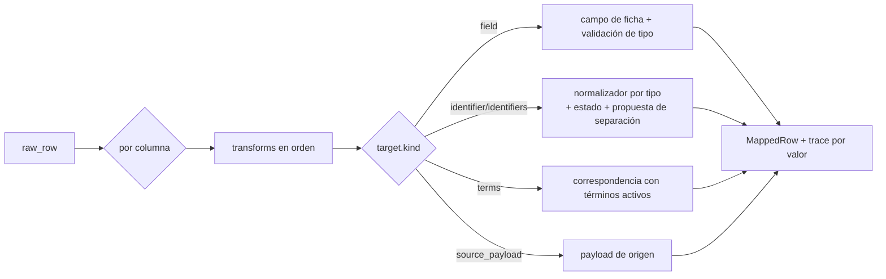

## Context

- `import_mapping_template` ya existe (`name`, `source_name`, `header_signature` indexado, `mapping` JSON, soft-delete).
- `normalization.py` implementa N1–N7 con constantes en código: el conjunto público `ABSENCE_MARKERS` (comparado tras quitar espacios: vacío, `S/N`, `SN`, `S.N.`, `S/C`, `SC`, `S.C.`, `-`, `--`, `---`, `—`, `0`, `N/A`, `NA`, `SINCODIGO`, `SINCÓDIGO`, `SINNUMERO`, `SINNÚMERO`) [SUPUESTO A5], consultado por la función pública `is_absence_marker(raw)`, y los separadores de `_SPLIT_RE` (`/` salvo dentro de `S/N` y `S/C`, `;`, `|`, `,`, salto de línea) [SUPUESTO A8].
- La ficha (`piece`) usa `denomination`, `epoch_original_text`, `epoch_type`, `epoch_start_year`, `epoch_end_year`, `dimensions_text` y `dimensions` (lista de `{dimension, value, unit}`); el régimen de tenencia se guarda con códigos internos (`OWNED`, …) y la API los traduce a las etiquetas del contrato (`Propiedad`, …) según ADR-002 (`app/api/enums.py`).
- `importacion-pipeline-reconciliacion` necesita un contrato estable para avanzar en paralelo.

## Goals / Non-Goals

**Goals:**
- Un mapeo declarativo, serializable y versionado que explique cada valor transformado.
- Reutilizar la configuración entre cargas de la misma fuente.
- Sacar del código los parámetros de normalización `[SUPUESTO]`.

**Non-Goals:**
- Lenguaje de scripting de transformaciones (solo operaciones predefinidas).
- Detección automática de la semántica de columnas con IA.

## Decisions

### D1. `MappingSpec` v1 (contrato interno)

Decisiones aprobadas el 2026-10-21 con el dueño de `importacion-pipeline-reconciliacion`:

- **Forma pública = `ColumnMapping`.** `PUT /imports/{batch_id}/mapping` (`MappingRequest`: `template_id`, `sheet_name`, `header_row`, `columns`, `defaults`) y las plantillas (`MappingTemplateCreate.columns`, `MappingTemplateOut.columns`) siguen usando `ColumnMapping`. `MappingSpec` v1 es **interno**: se construye traduciendo `ColumnMapping` y `defaults`, y la API nunca lo expone. Si `ColumnMapping` necesita campos para transformaciones, `value_map` o vocabulario, se añaden como opcionales con valor por defecto, para que los cuerpos actuales sigan siendo válidos. Su forma exacta se acuerda con el dueño del pipeline antes de la tarea 3.1.
- **La hoja y la fila de cabeceras viven en `import_batch`** (`sheet_name`, `header_row`, columnas que ya existen), no en el spec. `MappingRequest` las sigue recibiendo como hoy.
- **Conversión explícita v0 → v1 al leer.** `batch.mapping` sigue guardándose en v0 (lo escribe `service.py`, del pipeline); las plantillas (`import_mapping_template`) se guardan en v1. `apply_mapping` y `validate_mapping` aceptan `MappingSpec` v0 o v1 y convierten internamente, para que `service.py` no cambie. Pasar el lote a v1 se acuerda con el dueño del pipeline. Al leer `import_batch.mapping` o `import_mapping_template.mapping`, una versión anterior se convierte con una función explícita, de modo que los lotes guardados y la plantilla del seed siguen funcionando. Se reconocen dos formas anteriores:
  - v0 del pipeline (`{"version": 0, "columns": [{source, target, identifier_type, split_compound}], "defaults"}`): un `target` de campo pasa a `{"kind": "field"}`; `identifier` sin `split_compound` pasa a `{"kind": "identifier", "type"}`; `identifier` con `split_compound` pasa a `{"kind": "identifiers", "default_type"}`; `payload` pasa a `{"kind": "source_payload"}`. Las transformaciones quedan vacías.
  - Forma de la plantilla del seed (`{columna: {"target": ...}}`, sin `version`): `identifiers:auto` pasa a `{"kind": "identifiers", "default_type": null}`, `payload` pasa a `source_payload` y el resto se trata como campo.
  - Una versión desconocida es un error explícito; nunca se adivina.

```json
{
  "version": 1,
  "columns": [
    {"source": "DENOMINACIÓN", "target": {"kind": "field", "name": "denomination"}, "transforms": ["trim"]},
    {"source": "CÓDIGOS", "target": {"kind": "identifiers", "default_type": "COLECCION"},
     "transforms": ["trim", "split_concatenated"]},
    {"source": "N° INV", "target": {"kind": "identifier", "type": "I"}, "transforms": ["absence_markers"]},
    {"source": "ÉPOCA", "target": {"kind": "field", "name": "epoch_original_text"}, "transforms": ["propose_period"]},
    {"source": "MATERIAL", "target": {"kind": "terms", "vocabulary": "MATERIAL"},
     "transforms": ["split:,", "value_map"], "value_map": {"madera policromada": "MADERA"}},
    {"source": "OBS. CONSULTORÍA", "target": {"kind": "source_payload"}}
  ],
  "defaults": {"tenure_regime": "OWNED"}
}
```

- Columnas del archivo no listadas → `source_payload` automáticamente (RF-008: nada se pierde).
- Modelo Pydantic v1 con `version: Literal[1]`; versiones futuras se migran con una función explícita. Los nombres que hoy importan el pipeline y sus pruebas (`ColumnSpec`, `MappingSpec`, `MappingContext`, `MappedRow`, `apply_mapping`, `validate_mapping`) conservan su uso actual; el modelo v1 interno puede tener un nombre propio.
- Los nombres de campo son los del modelo (`piece`). `propose_period` conserva el texto en `epoch_original_text` y escribe su propuesta en `epoch_type`, `epoch_start_year` y `epoch_end_year`.
- El spec guarda **códigos internos** (`OWNED`, códigos de término como `MADERA`, códigos de tipo de identificador); la API traduce los enumerados a las etiquetas del contrato al recibir y devolver plantillas (ADR-002). El nombre de la fuente no forma parte de `defaults`: es el `source_name` de la plantilla y del lote.
- Ejemplo con nombres de columna **ilustrativos** [SUPUESTO A1]; el término `MADERA` y la correspondencia `madera policromada` son ilustrativos sobre el vocabulario `MATERIAL` sembrado [SUPUESTO Q6, B5].

### D2. Motor de transformación



- Firma: `apply_mapping(raw_row: dict[str, Any], spec: MappingSpec, ctx: MappingContext) -> MappedRow`; `validate_mapping(spec, headers) -> list[MappingError]`. `MappingContext` precarga términos activos, tipos de identificador y parámetros de normalización (una sola consulta por lote).
- Cada valor transformado lleva `trace: [{"transform": ..., "before": ..., "after": ...}]` para explicar el resultado en la previsualización.
- **Alcance en este change** (decisión del 2026-10-21 con el dueño de `importacion-pipeline-reconciliacion`): las correspondencias con términos, las propuestas de época y medidas y la traza **solo se calculan para la previsualización** (D4). `apply.py` y `MappedRow.as_json` no cambian, así que lo que se guarda en `import_row.mapped_data` y lo que se aplica a la ficha sigue igual que hoy:
  - `MappedRow` puede llevar en memoria la traza, las propuestas y las correspondencias para la vista previa, pero no las serializa.
  - El texto original de una columna con destino `terms` se conserva en `source_payload` (RF-008).
  - `propose_*` no llena `epoch_type`, `epoch_start_year`, `epoch_end_year` ni `dimensions` en la ficha.
  - Una propuesta de medida con `"dimension": null` (medidas sin etiqueta) es válida en la previsualización.
- Transformaciones v1: `trim`, `upper`, `absence_markers`, `split_concatenated`, `split:<sep>`, `date:<formato>` (por defecto `dd/mm/yyyy`, `yyyy`) [SUPUESTO Q5], `propose_period` (intérprete de época nuevo, ver abajo), `propose_dimensions` (patrones `alto 23 cm`, `23 x 15 cm`; unidad `cm`) [SUPUESTO Q5], `value_map`, `default:<valor>`.
- `propose_period` requiere **construir el intérprete de época**: hoy `catalog` solo tiene `validate_epoch` (coherencia de años) y no interpreta texto. Se crea como función pura `interpret_epoch(text) -> EpochProposal | None` en `imports/epoch.py`, reutilizable más adelante por la ficha, con las reglas de B9 [SUPUESTO B9]: `s. XX` → `CENTURY` 1901–2000; `década de 1950` / `años 50` → `DECADE` 1950–1959; `1950` → `YEAR`; `1940-1950` → `RANGE`; `ca. 1950` → `APPROXIMATE` con amplitud de ±10 años, configurable; `3000 años` → `RELATIVE_AGE` sin años calculados. Un texto no reconocido no genera propuesta y el texto original queda intacto.
- `date:<formato>` solo se aplica a celdas de texto: una celda que el lector de Excel entrega como fecha (`datetime`/`date`) queda **exenta** del formato declarado y se toma tal cual, con la traza indicando que provenía de una celda de fecha.
- Las propuestas (`propose_*`) nunca sobrescriben el texto original: generan campos estructurados marcados como propuesta. `propose_dimensions` conserva el texto en `dimensions_text` y propone `dimensions` como lista de `{"dimension": "alto", "value": 23, "unit": "cm"}` (esquema `Dimension` de `catalog`) [SUPUESTO Q7]. En medidas sin etiqueta (`23 x 15 cm`) no se supone el orden alto × ancho: `dimension` queda `null`.
- Destino `terms`: un valor sin término correspondiente (ni por código, ni por etiqueta, ni por `value_map`) no se descarta ni crea términos: se envía al `source_payload` de la fila con su texto original y se cuenta en la vista previa. En este change, además, los valores con correspondencia solo se muestran en la vista previa; el texto de la columna completa queda en `source_payload`.
- `validate_mapping`: denominación mapeada (o `default`), columnas de la plantilla ausentes del archivo, destino duplicado para campos escalares, tipo de identificador o vocabulario inexistente.

### D3. Sugerencia de plantilla
`header_signature` = SHA-256 de cabeceras normalizadas (N1 + sin tildes) **ordenadas**. La sugerencia se pide **solo** por `POST /import-templates/suggest {headers}`: coincidencia exacta por firma → `score=1`; si no, `score = 0,5 × J + 0,5 × S`, donde `J` es el índice de Jaccard entre los conjuntos de cabeceras normalizadas y `S` el promedio, sobre las cabeceras de la plantilla, de la mejor razón `difflib.SequenceMatcher` contra las cabeceras del archivo [SUPUESTO Q1]; devuelve hasta 3 plantillas [SUPUESTO Q2] con `score ≥ 0,6` [SUPUESTO Q1], ordenadas por `score`, con columnas faltantes y columnas nuevas.

`GET /import-templates` solo lista las plantillas activas (filtro opcional por `source_name`); el parámetro `header_signature` del stub actual **se quita**, porque la sugerencia necesita las cabeceras y no solo su firma, y el contrato del equipo no lo define. El nombre de una plantilla es único entre las plantillas activas, sin distinguir mayúsculas ni tildes [SUPUESTO Q9].

Permisos [SUPUESTO Q8] (los tres códigos ya existen en la matriz sembrada, `app/seed/reference.py`; lo supuesto es su asignación a estas operaciones): listar, crear, editar, sugerir y vista previa exigen `imports.prepare` (Catalogador, Gestor de colecciones, Administrador); eliminar una plantilla exige `imports.approve` (Gestor de colecciones, Administrador); los parámetros de normalización y los alias de siglas exigen `vocabularies.manage` (Gestor de colecciones, Administrador).

### D4. Vista previa de normalización por columna
`POST /import-templates/{id}/dry-run`, solo sobre una plantilla guardada, con una muestra (hasta 200 filas [SUPUESTO Q3] de un lote `UPLOADED`/`MAPPED`, referenciado por `batch_id`): por columna, conteos de `NORMALIZED`, `UNPARSEABLE` (estados de `NormalizationStatus`) y de las categorías de vista previa `ABSENT` y `SPLIT_PROPOSED`, valores sin término correspondiente (los 20 más frecuentes [SUPUESTO Q4]) y ejemplos con `trace`. No escribe nada.

### D5. Parámetros de normalización como datos
Tabla nueva `normalization_setting` (clave, valor JSON, auditada, soft-delete) con `absence_markers` y `concatenation_separators`; tabla `collection_acronym_alias` (alias normalizado → `collection_id`, p. ej. una sigla histórica). Los valores iniciales **salen de las constantes del código**: `absence_markers` = el contenido exacto de `ABSENCE_MARKERS` y `concatenation_separators` = los separadores de `_SPLIT_RE` (con la excepción de `/` dentro de `S/N` y `S/C`), no de la lista resumida de A5/A8. El normalizador recibe los parámetros por inyección (`NormalizationParams`) con esas constantes como defaults, de modo que las pruebas existentes del normalizador siguen pasando sin cambios. `ABSENCE_MARKERS` sigue siendo un `frozenset` público del módulo (los defaults) e `is_absence_marker(raw)` conserva su firma y su resultado cuando no se le pasan parámetros; los valores vigentes se pasan con un argumento opcional solo de palabra clave. Cambiar un parámetro reutiliza el flujo de vista previa + confirmación de `colecciones-y-vocabularios-admin` (recalcular valores normalizados afectados); si ese change no está aplicado, la edición de parámetros solo se permite mientras no haya identificadores afectados.

## Risks / Trade-offs

- **Contrato compartido con el pipeline** → cualquier cambio de `MappingSpec` exige incrementar `version` y coordinar con la célula; prueba de contrato compartida en `tests/imports/test_mapping_contract.py`.
- **Alias de siglas mal configurados** pueden unir colecciones distintas → alias único por valor normalizado y vista previa obligatoria.
- **Formatos de fecha ambiguos** (`03/04/1998`) → formato explícito por columna; sin adivinar.
