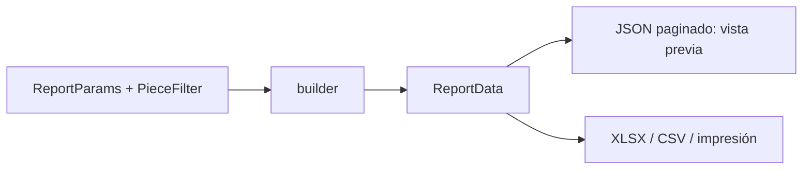

## Context

- `reports/registry.py`: catálogo cerrado `REPORTS` de `ReportDefinition(type, title, description, builder)`; `ReportParams` solo tiene `collection_id`, `location_id`, `include_loans_for_use` y `not_verified_since_days`.
- `reports/builders.py`: `ReportData(title, columns, rows, subtotals, totals, filters, masked_columns, message)`; `INVENTORY_COLUMNS` y `LOCATION_COLUMNS` sin descripción.
- `GET /reports/{report_type}` (`api/v1/quality_reports.py`) devuelve JSON paginado o, con `format`, el archivo (XLSX, CSV); los grandes van a un trabajo en segundo plano (202). `ReportType` es un enumerado del contrato.
- La spec `busqueda-reportes` ya exige un **filtro de piezas único para búsqueda, exportación y reportes** (`search/filters.PieceFilter`), pero los reportes aún no lo usan.
- Frontend: `components/domain/ReportsLive.tsx` (~330 líneas) con `ReportTable` simple y una vista de impresión agrupada.

## Goals / Non-Goals

**Goals:** cubrir los cinco reportes pedidos con un solo reporte; descripción en todos; vista previa clara e igual a la descarga.

**Non-Goals:** formatos oficiales, gráficos, reportes guardados, agrupación doble.

## Decisions

### D1. Un reporte `by-attribute` con `group_by` y `PieceFilter`

- `ReportParams` suma `group_by: GroupBy | None` y `piece_filter: PieceFilter | None`. El endpoint acepta los mismos parámetros de consulta que `/search` (se reutiliza la dependencia que construye `PieceFilter`).
- `GroupBy` (enumerado de la API): `provenance`, `denomination`, `author`, `material`, `conservation_state`, `category`, `collection`.
- Fuente de cada atributo:

| `group_by` | Origen | Varios por pieza |
|---|---|---|
| `provenance`, `denomination`, `author` | Texto de la ficha, agrupado por clave plegada (minúsculas, sin tildes, espacios colapsados); etiqueta = forma más frecuente | No |
| `material`, `category` | Términos de la pieza | Sí |
| `conservation_state` | Estado vigente (última evaluación o campo de la ficha) | No |
| `collection` | Colección con su ruta | No |

- Total = piezas distintas; si `group_by` admite varios valores, `totals` incluye además «Apariciones en grupos» y `message` explica la diferencia.
- Columnas: las del inventario (con Descripción, D2) más la columna del atributo agrupado si no está ya.
- *Alternativa descartada*: cinco `ReportDefinition` nuevos. Repetiría el mismo builder cinco veces y cinco tarjetas en la UI.

### D2. «Descripción» en las columnas de piezas

`INVENTORY_COLUMNS` y `LOCATION_COLUMNS` insertan «Descripción» tras «Denominación». Los escritores de XLSX ajustan texto en esa columna (ancho fijo, `wrap_text`); la vista de impresión usa `white-space: pre-wrap` y ancho máximo. Los reportes de incompletas y valorización no listan piezas con detalle (o son agregados) y no cambian.

### D3. Vista previa = misma `ReportData`

La vista previa consume el JSON paginado del mismo builder que genera el archivo, así que filas, subtotales y totales coinciden por construcción. El JSON suma `generated_at`, `generated_by` y `filters` legibles (los `ActiveFilter` de `PieceFilter`) para el encabezado; los escritores de XLSX/CSV escriben el mismo encabezado en las primeras filas.

### D4. Frontend

- Selector de reporte con tarjetas (título + una línea). Al elegir «Piezas agrupadas por…»: selector de atributo y el mismo `SearchFilters` de `fusion-busqueda-deposito` (si aún no existe, se usa el panel de filtros actual y se reemplaza después).
- `ReportPreview`: encabezado, totales, tabla con encabezado fijo (`position: sticky`), grupos plegables con subtotal, celda de descripción recortada a 2 líneas con «ver más», paginación de 50 filas, aviso de columnas ocultas. `ReportsLive.tsx` se divide.

## Risks / Trade-offs

- **Cambia un enumerado del contrato** (`ReportType`). → Ampliación compatible (valor nuevo); se registra en el mapeo y se avisa al Líder.
- **Agrupar texto libre** puede juntar valores distintos o separar iguales con errores de tipeo. → Solo se pliega mayúsculas, tildes y espacios; la normalización de vocabularios es trabajo de `ia-sugerencia-terminos` y de las listas de valores.
- **Reportes grandes con descripción** pesan más. → La generación en segundo plano ya existe; la vista previa pagina.

## Migration Plan

Sin migración de datos.
