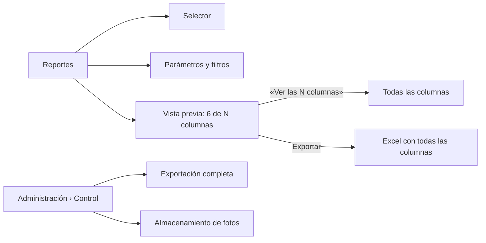

## Context

Estado de `main` al 2026-11-11 (ver proposal.md, «Why»):

- **`app/reportes/page.tsx`** monta `ReportSelector` y, según el modo, `ReportsLive` (conectado: todos los tipos, `ReportPreview`, exportar e imprimir) o la tabla de demostración (solo inventario, por colección y por ubicación, con los totales como `Object.entries(report.totals)` → «Totales: piezas: 14»). Debajo de cualquier reporte monta siempre `StorageEstimateCard` (título «Volumen fotográfico (RNF-003)») y, con `exports.full`, `FullExportPanel` o su versión de demostración.
- **`ReportPreview`** pinta `report.columns` completas. El inventario trae 19 columnas (`INVENTORY_COLUMNS`, `apps/api/app/modules/reports/builders.py`); el agrupado, 20 (añade la del grupo); por ubicación, 7 (`LOCATION_COLUMNS`); incompletas, 3.
- **Desplegables:** `ReportFilters` (`ReportsLive.tsx:103`), «Más filtros» (`SearchFilters.tsx:195`) y «Subtotales» (`ReportPreview.tsx:169`) son `
` con `
`. Con `display: flex` el `summary` deja de ser `list-item` y el navegador no pinta su triángulo: el desplegable parece un título.
- **Administración › Control** (P5) lista sus secciones en `AdminShell.tsx` (`papelera`, `auditoria`, `exportacion`, con `area: "control"`, `?pestana=<slug>`) y las monta en un `switch` de `app/administracion/page.tsx`. La exportación completa ya está ahí (`exportacion`, permiso `exports.full`).
- **`GET /api/v1/media/storage-estimate`** exige `reports.view`; la tarjeta no necesita otro dato.
- **Números:** la aplicación formatea con `toLocaleString("es-PE")` en 38 lugares; en ICU, `es-PE` produce «25,000» y «0.2». No hay números con otro formato en Reportes: el requirement solo fija la regla y una prueba la vigila.
- **Demostración:** `computeInventoryReport` (`lib/fixtures/kpis-reports.ts:90`) recorre todas las `PIECES` sin filtrar el régimen; una es «Préstamo Temporal».
- Restricciones: no tocar el menú, el layout ni los átomos de `components/ui` (Base); no rediseñar Administración › Control (C23, P5); deltas `ADDED` salvo el `MODIFIED` acordado (ADR-010).

## Goals / Non-Goals

**Goals:**
- Que la pantalla de Reportes muestre solo reportes y que la vista previa quepa a 1366 px sin cortar columnas.
- Que los desplegables se reconozcan como tales en las tres pantallas, sin cambiar sus nombres.
- Cumplir 16 px y 44 px en Reportes, incluido el reporte de incompletas, sin desbordar a 360 px.

**Non-Goals:**
- Cambiar la API, el Excel, la impresión o el orden de las columnas (W2).
- Cambiar qué hace `StorageEstimateCard` o rediseñar Administración › Control.

## Decisions

### D1. Columnas principales por tipo de reporte, en una sola tabla de configuración
`lib/data/reports.ts` gana `PREVIEW_COLUMNS: Partial<Record<LiveReportType, readonly string[]>>` con los nombres de columna principales de cada reporte (W8):

| Reporte | Columnas principales |
|---|---|
| Inventario general, por colección | Código I, Código de colección, Denominación, Descripción, Colección, Régimen |
| Piezas agrupadas | las mismas seis (la columna del grupo ya va en el encabezado de cada grupo) |
| Por ubicación | Código I, Código de colección, Denominación, Descripción, Ubicación, Última vez vista |
| Incompletas | sin recorte (3 columnas) |

Función pura `previewColumns(report, showAll)` → índices de las columnas a pintar, en el orden de `report.columns`. Si alguna principal no viene en el reporte (por permisos o cambio de API) se omite sin error; si el reporte trae 6 columnas o menos, se pintan todas y no hay control. `ReportPreview` recibe `showAll` y pinta solo esos índices en el encabezado y en cada fila: **las filas, los grupos, los subtotales y los totales son los mismos objetos del reporte**, así que siguen idénticos a la descarga. La línea «En pantalla: 6 de 19 columnas. El Excel las trae todas.» y el botón «Ver las 19 columnas» / «Ver solo las principales» van encima de la tabla.
**Descartado:** columnas elegibles una por una (más opciones en pantalla, contra RNF-010) y recortar en la API (cambiaría el Excel y el contrato).

### D2. El `MODIFIED` se coordina con André Asenjo
El requirement «Vista previa del reporte fiel a la descarga» viene de `reportes-por-atributo` (archivado el 2026-11-02, hecho por André Asenjo según `git log`). El `MODIFIED` copia el requirement entero y cambia solo la fidelidad de columnas: filas, grupos, subtotales, totales, encabezado y aviso de permisos siguen igual. **André revisa el PR** y da el visto bueno al `MODIFIED` antes de aprobarlo (ADR-010: un `MODIFIED` exige coordinación con quien hizo el requirement). Ningún otro change abierto toca este requirement (comprobado el 2026-11-11).

### D3. Desplegables: flecha propia, nombre igual
El `summary` conserva `flex` (alto de 44 px y foco) y gana un icono `ChevronRight` que gira 90° con `group-open:rotate-90` (el `
` lleva `group`). Así la flecha no depende del triángulo nativo, que `flex` quita, ni del navegador. Los nombres «Filtros», «Más filtros» y «Subtotales» no cambian, porque los usan el requirement vigente «Filtros priorizados en la búsqueda» (`fusion-busqueda-deposito`, sin archivar) y el manual. «Filtros» ya cuenta los activos («Filtros (2 activos)»); «Más filtros» hace lo mismo con los suyos. Un componente pequeño `DisclosureSummary` en `components/domain` evita repetirlo tres veces.
**Descartado:** renombrar a «Mostrar filtros / Ocultar filtros» (obligaría a un `MODIFIED` de un change ajeno sin archivar y a cambiar el manual).

### D4. «Almacenamiento de fotos» en Administración › Control, en un commit aparte
Se añade una entrada a `AdminShell.tsx` (`slug: "almacenamiento"`, `label: "Almacenamiento de fotos"`, `area: "control"`, `permissions: ["users.manage"]`, la misma puerta que el menú de Administración) y un `case` en `app/administracion/page.tsx` que monta `<StorageEstimateCard devUser=… />` tal cual. El título interno de la tarjeta pierde «(RNF-003)». Nada más de la pantalla cambia. Va en su propio commit y **P5 lo revisa**; se le avisa antes por el trabajo de C23 en la misma pantalla. En el mismo commit, Reportes deja de montar la tarjeta, para que la estimación nunca quede sin pantalla.
**Descartado:** `/estado` (es soporte y no está en el menú, así que el Administrador no la encontraría) y quitarla sin moverla (incumple «Estimación del volumen fotográfico» de `multimedia`).

### D5. Totales y números
*Corregido al aplicar (2026-11-11):* `totalsText` no producía frases, sino `clave: valor` («Piezas: 2 · Propiedad: 2»), también en modo conectado. Se cambia `totalsText` mismo, así que vale para los dos modos y para la impresión (`ReportSummary`). Los totales conocidos se leen en frase («2 piezas · 1 en comodato · 3 nunca verificadas»). Lo que no tiene frase, como «Total PEN», queda como nombre y valor. Los números se formatean con `es-PE` también en los subtotales y en el encabezado de cada grupo, que antes mostraban «10000». La tabla de demostración se reemplaza por `ReportPreview`, el mismo del modo conectado, así que recibe las columnas principales, los totales y los desplegables sin código duplicado; la columna «Régimen de tenencia» de los datos de ejemplo pasa a «Régimen», como en la API. `filtersText` no cambia: la API ya envía los nombres de los filtros en español («Colección», «Comodatos»). La clave `collection` solo existía en los datos de las pruebas.

### D6. Legibilidad de Reportes e incompletas
`text-xs` y `text-sm` → `text-base` en `ReportSelector`, `ReportsLive` (parámetros), `ReportPreview` e `IncompleteReportPanel`. Casillas de alerta y botones de página con `min-h-11` en su etiqueta o control. Las etiquetas de `Field` (átomo de la Base, 14 px) se suben a 16 px solo en esta vista con un selector del contenedor, como en C26 (`[&_label]:text-base [&_p]:text-base`). La tabla vive en un contenedor con `overflow-x-auto` y `max-w-full`, y el contenedor de la página con `min-w-0`, para que el desborde a 360 px quede dentro del recuadro (hoy lo provoca la fila de casillas de alerta de incompletas y la tabla del inventario).

### D7. Demostración con las reglas del inventario
`computeInventoryReport`, `computeByCollectionReport` y `computeByLocationReport` filtran `tenure_regime !== "Préstamo Temporal"`. El total del inventario de ejemplo pasa de 14 a 13 piezas; las pruebas que contaban 14 se ajustan explicando que el préstamo temporal nunca debió contar (RN-004).

## Risks / Trade-offs

- [Alguien busca una columna que ya no ve en pantalla] → la línea «En pantalla: 6 de 19…» y el botón están junto a la tabla; el Excel sigue completo. Se observa en la prueba humana (HU-21: «¿qué columnas faltan o sobran?»).
- [Las columnas principales no son las que usa el museo] → `[SUPUESTO]` W8, una sola tabla de configuración para cambiarlas.
- [La Curadora necesitaba la estimación del volumen] → `[SUPUESTO]` W9; si la necesita, se cambia el permiso de la sección a `reports.view` sin tocar nada más.
- [Conflicto con C23 en Administración] → commit aparte, pequeño, revisado por P5.
- [Conflicto con `revisar-pendientes-unificado` en `IncompleteReportPanel`] → C26 no modifica ese archivo, solo lo monta; el que se fusione segundo rebasa sin conflicto de contenido esperado.

## Migration Plan

Solo frontend. Despliegue normal. Los enlaces a `/reportes` siguen funcionando; la estimación del volumen se encuentra en `/administracion?pestana=almacenamiento`. Reversión con `git revert` (no hay datos ni migraciones).

## Open Questions

- Texto exacto del botón cuando todas las columnas están a la vista («Ver solo las principales»): se ajusta tras la prueba humana sin cambiar la spec.
