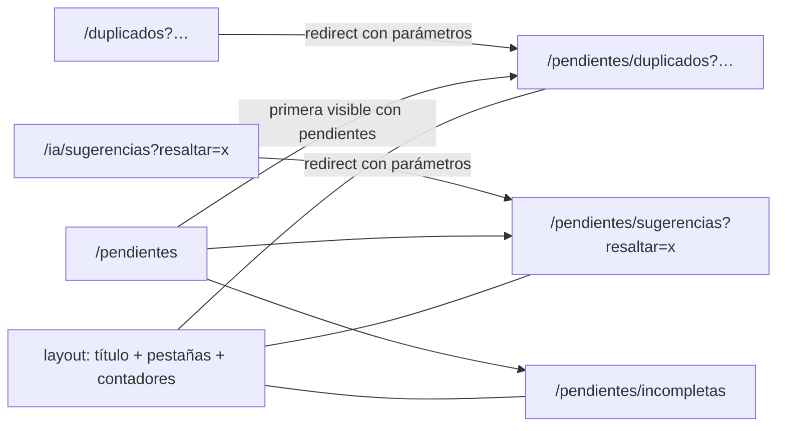

## Context

Hoy hay tres pantallas independientes (ver proposal.md, «Why»):

- **`/duplicados`** (`app/duplicados/page.tsx`, 316 líneas) tiene una sola implementación; `lib/data/duplicates` alterna entre los datos de demostración y la API. Cada par se pinta con `DuplicateCandidateCard` (`components/domain/DuplicateReview.tsx`, 846 líneas): `SimilarityMeter` de 96 px, chips de señales, `ComparisonTable`, `SignalList` plegado y tres botones. `signalLabel` cae en `signal.field` cuando no conoce la señal, y `identifierTypeLabel` (`status-intents.ts`) solo traduce `COLLECTION`, `OWNER` y `OTHER`, mientras que los tipos sembrados son `I`, `COLECCION`, `INC_RN`, `PUCP`, `PROPIETARIO` y `OTRO`: `INC_RN` llega a la pantalla tal cual.
- **`/ia/sugerencias`** tiene dos implementaciones: en modo demostración, `SuggestionCard` dentro de la propia página (lee `?resaltar=`); en modo conectado, `AiSuggestionsLive`, que usa `AiSuggestionCard` de `AiSuggestPanel.tsx`. Las dos son de P4.
- **Piezas incompletas** vive en Reportes como `IncompleteReportPanel`, que funciona en los dos modos (en demostración no descarga archivos).

Totales disponibles sin endpoint nuevo:

| Cola | Consulta | Total |
|---|---|---|
| Duplicados | `GET /api/v1/quality/duplicates?status=PENDING` vía `fetchDuplicateQueue` | `page.total` (también en demostración) |
| Sugerencias | `GET /api/v1/ai/suggestions?status=PENDING` (`page_size` 1–100) | La API devuelve `total`, pero `listPendingAiSuggestions` lo descarta y devuelve solo `items` |
| Incompletas | `GET /api/v1/quality/incomplete` vía `fetchIncompleteReport` | `page.total` (también en demostración) |

Restricciones: el menú (`navigation.ts`) es de la Base y no se toca; la spec `ia-asistiva` y el contenido de la pestaña de sugerencias son de P4; deltas solo `ADDED` (ADR-010). El requirement vigente «Comparación de pares con la similitud destacada» exige la similitud en cifra grande con indicador visual al abrir el par. Esta versión de Next.js cambia convenciones (`apps/web/AGENTS.md`): antes de escribir el layout y las redirecciones se lee la guía en `node_modules/next/dist/docs/`.

## Goals / Non-Goals

**Goals:**
- Una vista de pendientes con direcciones estables por pestaña, que funcione en los dos modos.
- Reducir la pestaña de duplicados a una fila por par sin perder ninguna acción ni la regla vigente de la comparación.
- Cero nombres internos visibles en duplicados.

**Non-Goals:**
- Cambiar el contenido o el comportamiento de la cola de sugerencias, el reporte de incompletas, el asistente de fusión o la detección.
- Tocar el menú lateral, el Inicio o `status-intents.ts` (compartido con la ficha de P1).

## Decisions

### D1. Pestañas como rutas anidadas bajo un layout
`app/pendientes/layout.tsx` pinta el título «Revisar pendientes» y la barra de pestañas; cada pestaña es una ruta (`duplicados/page.tsx`, `sugerencias/page.tsx`, `incompletas/page.tsx`) y `app/pendientes/page.tsx` elige la pestaña inicial y redirige. Las pestañas son enlaces dentro de un `<nav aria-label="Pendientes">`, con `aria-current="page"` en la activa (no `role="tablist"`: cada pestaña es una página con su propia dirección, y así funcionan el botón «Atrás», abrir en otra pestaña del navegador y los enlaces compartidos).
**Descartado:** una sola página con `?pestana=` y estado local (el cambio de pestaña no queda en el historial y el `isActive` del menú no lo reconoce).

### D2. Elección de la pestaña inicial y visibilidad
Función pura `pendingTabs(hasPermission)` → pestañas visibles en orden fijo (duplicados: `duplicates.resolve`; sugerencias: `ai.review`; incompletas: `reports.view`) y `initialTab(visible, counts)` → la primera con `count > 0`, si no la primera visible, si no ninguna (aviso «Su rol no tiene pendientes que revisar»). Un conteo desconocido (`null`) no cuenta como «tiene pendientes». En `/pendientes` se muestra «Cargando…» hasta que lleguen los totales o fallen. Una pestaña sin permiso abierta por su dirección muestra `PermissionNotice` dentro del layout, con las pestañas visibles arriba.

### D3. Contadores desde las consultas existentes
`lib/data/pending.ts` (nuevo, de P2) expone `fetchPendingCounts(devUser)`, que lanza las tres consultas en paralelo con `page_size: 1` y devuelve `{ duplicates, suggestions, incomplete }` con `number | null`. Para duplicados e incompletas reutiliza `fetchDuplicateQueue` y `fetchIncompleteReport`. Para sugerencias hace la misma llamada `GET /api/v1/ai/suggestions` con `status=PENDING&page_size=1` y lee `total`; en demostración cuenta las pendientes de `useMockStore`. **No se modifica `lib/data/ai.ts`** (de P4). Cualquier fallo → `null` → pestaña sin número (decisión del equipo). Los contadores se recalculan al montar el layout y cuando una pestaña avisa de que resolvió algo (callback `onResolved` del contexto del layout).
**Descartado:** endpoint de conteo nuevo (decisión del equipo) y cambiar `listPendingAiSuggestions` para devolver el total (archivo de P4).

### D4. Fila compacta con detalle desplegable; la regla vigente se cumple en el detalle
`DuplicateCandidateRow` (nuevo, en `DuplicateReview.tsx`) muestra las dos piezas, el nivel en palabras a partir de `similarityLevel` (alta → «Muy parecidas», media → «Parecidas», baja → «Poco parecidas»), el motivo principal (la señal con mayor `contribution`, si no la de mayor `similarity`) y «Revisar» con `aria-expanded`. Al abrirla, monta debajo la `DuplicateCandidateCard` actual, que conserva `SimilarityMeter`, la comparación y las acciones. Así se cumple el requirement vigente «Comparación de pares con la similitud destacada» (el par abierto «abre con la similitud como dato principal») sin un `MODIFIED`. Estado `openId` en la página: abrir uno cierra el anterior. Tras resolver, se recarga la cola y el foco va a la fila que ocupa la misma posición o al aviso de resultado (`ref` + `focus()` tras la recarga).
**Descartado:** abrir el par en un diálogo (otro nivel de ventanas sobre el asistente de fusión, que ya es un diálogo) o en una ruta propia (más trabajo y la fusión depende del estado de la cola).

### D5. Etiquetas desde los tipos de identificador del sistema
Los tipos son parametrizables (RN-010), así que el nombre visible sale de `GET /api/v1/identifier-types` (`label`), que la pestaña carga una vez junto a las colecciones. `signalLabel` recibe un mapa `code → label` opcional; sin mapa, o con un código desconocido, usa un mapa local con los seis tipos sembrados (y los tres códigos en inglés de los datos de demostración) y, si tampoco está, «Otro código». Una señal de identificador se lee «Coincide: {nombre del tipo}», que funciona con cualquier nombre que ponga el Administrador; una señal que no se conoce es «Otro dato». El mismo nombre se usa en la fila «Otros códigos» de la comparación. La caída por defecto de `signalLabel` deja de devolver `signal.field`. Los nombres de campo de la comparación ya están en español (`COMPARISON_ROWS`); se añade una prueba que pinta la lista y el detalle con todas las señales de los fixtures más una desconocida, y comprueba que no aparece ninguno de los nombres internos (`signal` y `field` de cada señal, y los códigos de tipo cuyo nombre visible es distinto del código, como `INC_RN` o `COLECCION`; `I` y `PUCP` se excluyen porque su nombre visible coincide con el código). `status-intents.ts` no se toca (lo usan la ficha y el asistente de fusión); se avisa a P1 del hallazgo.
**Descartado:** ampliar el mapa compartido de `status-intents.ts` (cambia la ficha de P1 y sigue sin cubrir los tipos que cree el Administrador).

### D6. Las pantallas actuales se mueven a componentes, sin cambiar su comportamiento
- `DuplicateQueue` sale de `app/duplicados/page.tsx` a `components/domain/DuplicateQueue.tsx` y se adapta a la fila compacta (es de P2).
- El contenido de `app/ia/sugerencias/page.tsx` (rama de demostración y montaje de `AiSuggestionsLive`) se mueve **tal cual** a `components/domain/AiSuggestionsQueue.tsx`, con una sola prop nueva `embedded` que oculta su `<header>` propio para no repetir el `h1` dentro del layout. Ningún texto, tarjeta ni regla cambia; el PR lo revisa P4.
- `app/duplicados/page.tsx` y `app/ia/sugerencias/page.tsx` quedan como redirecciones con el mismo patrón que `app/deposito/page.tsx` (`redirect()` dentro de `Suspense` con `useSearchParams`), usando una función pura `legacyPendingTarget(base, params)` que copia todos los parámetros.
**Descartado:** redirecciones en `next.config` (no son comprobables con las pruebas unitarias actuales y el proyecto ya usa el patrón por página).

### D7. Legibilidad solo en lo propio
Layout, pestañas, filas compactas y filtros de duplicados pasan a `text-base` (16 px) como mínimo y `min-h-11` (44 px). La `DuplicateCandidateCard` desplegada sube a 16 px los textos que hoy son `text-xs`/`text-sm`. El contenido de la pestaña de sugerencias y el `IncompleteReportPanel` no se tocan (P4 y C28).

## Risks / Trade-offs

- [El menú sigue mostrando «Duplicados» y «Sugerencias IA» hasta que la Base actúe; la entrada no se resalta en `/pendientes/...`] → las redirecciones mantienen todo funcionando; la petición está en el proposal y la prueba humana de HU-29 queda condicionada a ella (tasks 6.2).
- [Tres consultas extra al abrir la bandeja] → `page_size: 1`, en paralelo y sin reintentos; si una tarda, la pestaña aparece sin número.
- [El contador de incompletas cuenta piezas con cualquier alerta, no «pendientes de decisión»] → se acepta como «piezas por completar»; `[SUPUESTO]` registrado.
- [`GET /identifier-types` podría exigir un permiso de administración] → se verifica en la tarea 3.1; si lo exige, se usa solo el mapa local de los seis tipos sembrados y «Otro dato».
- [Mover `AiSuggestionsQueue` choca con trabajo de P4 en la misma página] → avisar a P4 antes de empezar; el movimiento es un PR pequeño y puro (tarea 1.3), separado del resto.
- [Una fila compacta oculta información que antes se veía] → la comparación completa queda a un clic, en el mismo lugar; se mide en la prueba humana (HU-04).

## Migration Plan

Solo frontend. Despliegue normal; las direcciones antiguas redirigen, así que los enlaces del Inicio, los guardados y los del manual siguen funcionando. Reversión: volver a las páginas anteriores con `git revert`; no hay datos ni migraciones.

## Open Questions

- Texto final de los niveles («Muy parecidas / Parecidas / Poco parecidas») y del motivo principal: se ajusta tras la prueba humana sin cambiar la spec más allá de los ejemplos.
